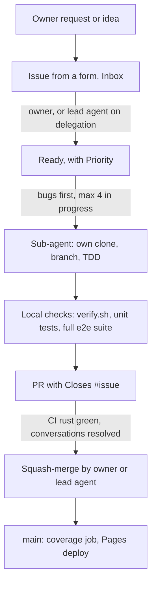
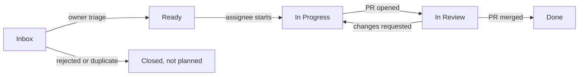

# Workflow

This is the only way work happens on AB-ALONE. It applies to humans and AI agents alike.
If a step is not written here, it does not happen. If something does not fit, open a `Decision`
issue to change this file first.

**Owners:** @TidyMaze and @Varadiell. Owners decide. They can delegate triage and merging to the
**lead agent** (the AI agent an owner drives), see section 9.

## A collaboration project

AB-ALONE is built by several people, each with their own AI agents, working at the same time on
the same repo. Nobody here is the only developer. Every action is decided and done with the other
contributors in mind:

- **Look before you act.** Check open issues, open PRs and the project board first. Someone may
  already be on it, or about to change the code you touch.
- **Decisions that affect others are shared.** A change to a rule, a spec, the CI, the branch
  protection or a shared API goes through an issue the other owner can see and answer before it
  lands. Delegation to an agent covers your own work, not the other owner's.
- **Respect others' work.** Their assigned issues and open PRs are theirs (rules 13 and 14). Their
  decisions stand until changed in a `Decision` issue.
- **Merge with care.** Before merging, check that your PR does not break or silently conflict with
  someone else's open PR. If it will force them to rebase, say so in their PR.
- **Leave the shared space clean.** Do not leave servers, branches or half-done work that others
  stumble on. Close what you open.
- **Say what you do.** Comment on the issue when you start, block, change course or stop, so the
  others never have to guess.

## 0. The flow at a glance



No human review is required: a PR merges as soon as the required CI check `rust` is green and every
conversation is resolved. Quality comes from strict TDD, 100 % unit coverage of all code and the
full e2e suite run locally before every merge (decision #445).

## 1. The golden rules

1. **No work without a `Ready` Task or Bug.** Every PR closes at least one `task` or `bug` issue
   whose Status was `Ready` when work started. It may close several when they are linked (same
   feature or same files, rule 17), one `Closes #n` line each.
2. **No Task without a parent.** Every Task is a sub-issue of a Feature, or of an Epic for
   non-player-facing work (tooling, CI, specs).
3. **No direct push to `main`.** Everything goes through a PR. It merges once the CI check `rust`
   is green and conversations are resolved, with no review required (section 6.4).
4. **Out of scope = new issue.** Anything found during a task that is not in its acceptance
   criteria becomes a new issue in `Inbox`. It never goes into the current PR.
5. **Decisions live in `Decision` issues**, never only in a PR thread, a commit or a chat.
6. **Nothing outside the repo.** If it was said in a chat or a call, write it in the right issue
   or it does not count.
7. **Finish before you start.** You may not start a new Task while one of yours is not `Done`
   (`In Progress` or `In Review` both count as not finished). Blocked does not free you: get it
   unblocked, or ask an owner to move it back to `Ready` and unassign you. At most **4 tasks** are
   `In Progress` at the same time across all agents, one per agent.
8. **Strict TDD, 100 % coverage.** No production code without a failing test first. Unit tests
   plus end-to-end integration tests. See section 11.
9. **This repo is public.** Never commit a secret. See section 12.
10. **Every bug goes through an issue first.** No fix, not even a one-liner, without a `bug` issue
    created from the form. See section 6.7.
11. **Bugs before features.** A `Ready` bug is always picked before any `Ready` task of the same
    or lower priority, and an open bug is never below `P1`.
12. **Test in a real browser regularly.** The full Playwright suite runs locally on every PR before
    it merges (CI runs it only on a manual dispatch, decision #445), and a manual Chrome check before merging a
    player-facing change. See section 11.
13. **Always assign yourself.** Before working on an issue or a PR, assign it to yourself (an agent
    assigns its driving owner and says so in a comment). Unassigned work does not exist.
14. **Hands off what others hold.** Never work on, push to, rebase or take over an issue or PR
    assigned to someone else without their explicit consent, written in the issue or PR. Let them
    finish until it is `Ready` or merged. If it blocks you, ask in a comment and wait.
15. **No stacked branches.** Every branch starts from an up-to-date `main` and targets `main`.
    Never base a branch on another unmerged branch. If your work needs another PR, wait until it is
    merged, then branch from `main`.
16. **Finish PRs properly, do not pile them up.** Prefer getting one PR ready, green and merged over
    working on many PRs at the same time and merging none. Every open PR goes out of date each
    time another one merges, and each rebase means a conflict to resolve, checks to rerun and a CI
    wait: many open PRs mean rebase loops and wasted time. In practice: merge a ready PR before
    you open another one; do not start a new Task while a PR of yours waits on a rebase, a red
    check or a missing screenshot; PRs that touch the same files go one after the other, never in
    parallel (the second branches from `main` after the first merges); the lead agent does not
    launch a new sub-agent task while it can finish or merge an open PR instead.
17. **Minimal, KISS.** Each issue, task and PR is minimal: **one thing, done well**, the simplest
    way that works. No extra feature, no refactor on the side, no option nobody asked for, no
    abstraction for later. If a request holds several things, split it into several issues.
    **Linked issues may share one PR** to go faster and avoid rebase loops: same feature, same
    files, or one needs the other (for example two settings in the same menu). Unrelated work
    never shares a PR. Anything found on the way becomes a new issue, never a bigger PR. When two
    solutions work, take the smaller one.
    **Group small open issues.** When several small open issues look doable together in one PR
    (same feature or same files, a few lines each, or the same kind of fix such as several slow
    tests), the one picking work groups them instead of doing them one by one: one branch, one
    PR, one `Closes #n` line each, every issue assigned and `In Progress` together. A duplicate is
    closed in favour of the older issue. Groups stay reviewable (rule 18); issues held by someone
    else join a group only with their holder's written consent (rule 14).
18. **Reviewable size.** A reader must be able to review any issue, Decision or spec PR in one
    sitting. A Decision asks **one question**, gives 2 or 3 options and a recommendation, and its
    body reads in about 5 minutes (roughly 500 words at most). A spec PR covers **one topic** (one
    file or one section) and stays around 300 changed lines at most. Detail that is not decided
    yet stays out, or goes in a later issue, instead of one large plan up front. Too long: split
    it before asking for a review (#361, after #313).

## 2. Where things live

| Place | Holds | Never holds |
|---|---|---|
| **Discussions** | Raw ideas (`Ideas`), priority votes (`Polls`), open chat (`General`) | Work to do |
| **Issues** | Epics, Features, Tasks, Decisions: the content of each work item | Brainstorming |
| **Project** ([AB-ALONE](https://github.com/users/TidyMaze/projects/1)) | Status, priority and order of every issue: **the backlog** | Content (it stays in the issue) |
| **Pull requests** | The change for one Task, and its review | New scope, decisions |

## 3. Work item types (label)

| Type label | What it is | Size | Parent | Closed when |
|---|---|---|---|---|
| `epic` | One phase of SPEC.md (Phase 0 to 5, one per milestone), plus the `Project setup` epic for specs, workflow and tooling | Weeks | none | All its children are done |
| `feature` | Something a player can see or do | Several Tasks | Epic | Owner verified every acceptance criterion |
| `task` | One PR worth of work | 1 PR, ideally under a day | Feature or Epic | Its PR is merged |
| `bug` | Something that works differently from its spec or acceptance criteria | 1 PR | The broken Feature, if known | Its PR is merged (with the reproducing test) |
| `decision` | A choice between options | n/a | optional | An owner writes the chosen option and closes it |

Parent links use GitHub **sub-issues** (issue page, "Create sub-issue" or "Add existing issue").

## 4. Status flow (`Status` field)



| Status | Meaning | Who moves it here | Gate to enter |
|---|---|---|---|
| `Inbox` | New, not triaged yet | Whoever creates the issue | Issue created from a form |
| `Ready` | Can be picked up | **Owners**, or the lead agent when an owner delegates | Definition of Ready (section 5) |
| `In Progress` | Someone is on it | The assignee | Assigned, "taking it" comment |
| `In Review` | PR open | The assignee | PR open with `Closes #<task>` |
| `Done` | Finished | GitHub (PR merged / issue closed) | Definition of Done (section 5) |

## 5. Definitions of Ready and Done

**Feature is Ready when:**
- [ ] Problem and player-facing outcome are written
- [ ] Acceptance criteria are a checklist an owner can verify by hand
- [ ] Linked to the spec section that defines it
- [ ] Milestone, `Priority` and parent Epic are set
- [ ] Split into at least one Task sub-issue

**Task is Ready when:**
- [ ] Parent Feature or Epic is set
- [ ] One-sentence outcome and a done checklist are written
- [ ] Fits in one PR
- [ ] Open questions are answered (no linked open `Decision`)
- [ ] `Priority` is set

**Task is Done when:**
- [ ] Its PR is merged into `main`
- [ ] Every item of its done checklist is ticked
- [ ] CI is green (once CI exists)
- [ ] Code changes: TDD commit order visible in the PR, 100 % line and region coverage, e2e test
      added or updated if a player flow changed (section 11)
- [ ] No secret in the diff (section 12)
- [ ] Specs or docs touched by the change are updated in the same PR

**Feature is Done when** all its Tasks are Done and an owner ticked every acceptance criterion,
then closed it.

## 6. The flows, step by step

### 6.1 Idea to Feature

1. Anyone posts the idea in Discussions, category **Ideas**.
2. When an owner wants it in the backlog, they create a **Feature** issue from the form, link the
   discussion, and the discussion gets a comment with the issue link.
3. The Feature lands in `Inbox`.

### 6.2 Triage (owners, or the lead agent on delegation)

An owner triages, or tells the lead agent to (for example "take the decisions"). Every decision
the lead agent takes on delegation is written as a comment in the issue. For each `Inbox` item,
the triager does exactly one of:
- **Accept:** complete it to the Definition of Ready, create its Task sub-issues, set `Priority`,
  move it to `Ready`.
- **Ask:** comment what is missing, keep it in `Inbox`.
- **Reject:** close as "not planned" with one line of why.

### 6.3 Doing a Task

1. Pick the next item in this order: **`Ready` bugs first** (highest `Priority` first), then
   `Ready` tasks by `Priority`. You may skip one only with a comment saying why. Bugs follow the
   same steps below, with "Task" meaning "Task or Bug".
2. Assign yourself, comment `taking it`, move it to `In Progress`.
   **WIP limit: one unfinished Task per contributor, at most 4 in progress overall** (rule 7; an
   agent counts as a contributor).
3. Branch from `main`: `<issue number>-<short-slug>`, for example `23-board-model`.
4. Blocked: add the `blocked` label, comment what blocks and @mention who can unblock. Keep the
   Status.
5. Scope changes mid-task: stop, comment on the Task, wait for an owner to update the Task before
   continuing.

### 6.4 Pull request

1. Open the PR from the template as a **draft** (`gh pr create --draft`). The body contains
   one `Closes #<task>` line per issue it closes (one issue, or several linked ones, rule 17).
   **A PR that changes the UI MUST include a screenshot in its
   description** (before and after when it changes an existing screen), in the "Screenshot"
   section of the template. A PR without one is not marked ready and not merged. Take it with
   Playwright (`page.screenshot`) or in Chrome. To put it in the body, push the image to the
   `pr-screenshots` branch (`pr-screenshots/<pr>-<name>.png`) and link it:
   ``.
   A human can also drag the image into the description. No UI change: write "no UI change".
2. Move the Task to `In Review`. A PR is **ready only when it is ready to merge**. While it is
   unfinished, in conflict, out of date or its local checks are red, it stays a draft. **CI does
   not run on drafts.** The order is: local checks green (`scripts/verify.sh`, unit tests, the
   full e2e suite), mark the PR ready (`gh pr ready`), CI runs (the `ready_for_review` event starts it),
   then merge. The author marks it ready; the lead agent does it for a sub-agent's PR after
   checking its report.
3. Review is **optional**. Anyone may comment; the author answers every comment in its thread and
   pushes fixes to the same branch.
4. A comment that adds scope gets the answer "new issue #N" and goes to `Inbox`.
5. **Merge gate.** A PR is merged into `main` only when all of these hold:
   - [ ] Checked locally: `scripts/verify.sh` green, unit tests green, and the **full e2e suite**
     green locally (`bun run e2e` from `client/`, on a random port, section 13). CI runs the e2e
     suite only on a manual dispatch (decision #445): the local result goes in the PR body, as the template's line "Full
     e2e suite run locally: N passed".
     **After a rebase on `main` without conflict**, rerun only `bun run test` and
     `bunx tsc --noEmit` in `client/` (rebuild the WASM first if `crates/` changed on main, section
     13), not `scripts/verify.sh` nor the e2e run: CI runs `rust` (Rust checks plus client `tsc`
     and unit tests) again on the rebased code, and main runs the Rust coverage after the merge
     (decision #239). A rebase with a conflict reruns every local check, the full e2e suite
     included.
   - [ ] CI: the PR is ready (not a draft) and the required check `rust` is green (enforced by
     branch protection, 0 approvals needed). GitHub counts a **skipped** required check as passing,
     so the merger must confirm that the run on the head commit really concluded `success`, not
     `skipped` (`gh run list --branch <branch>`). After a rebase, keep the PR a draft until the
     push is done, wait a few seconds, then mark it ready (bug #179).
   - [ ] A PR that changes the UI has its screenshot in the description (lead agent checks)
   - [ ] Every conversation resolved (enforced by branch protection)
   - [ ] Not required: the PR does not have to be up to date with `main` (decision #240, replaces
     #161: a merge queue needs an organization). Two green PRs can break `main` together, so a red
     `main` is the first bug to fix. Rebase your own PR when it conflicts, never someone else's
     (rule 14).
6. As soon as the gate passes, **an owner or the lead agent squash-merges into `main`**. Sub-agents
   never merge. A green PR is never left open: the Task is not `Done` until it is merged. GitHub
   closes the Task, the project sets `Done`, the branch is deleted.
7. Docs-only PRs (`**.md`, `docs/**`) skip CI, so the `rust` check never reports on them. An owner
   or the lead agent merges them with the admin bypass after reading the diff.

### 6.5 Decision

1. Anyone opens a **Decision** issue from the form: context, options, recommendation.
2. Discussion happens in its comments. Agents may recommend.
3. An owner closes it with the final comment `Decided: <option>`.
4. If a spec changes, a Task "Update spec for #N" is created and goes through the normal flow.

### 6.6 Priority vote

1. An owner opens a Discussion in **Polls**: one comment per candidate issue.
2. Everyone votes with a 👍 on each comment they want. No limit.
3. When both owners voted, an owner copies the counts into the `Votes` field, sets `Priority`
   (`P0` now, `P1` next, `P2` later, `P3` someday), labels the top ten `top10`, and closes the
   discussion.

### 6.7 Bug

1. Whoever finds a bug (human, agent, CI) opens a **Bug** issue from the
   form **before touching any code**: steps to reproduce, expected, actual, browser and commit.
   A bug found during another task is filed too, never fixed inside that task's PR.
2. It lands in `Inbox`. An owner triages it within the next triage: confirm, set `Priority`
   (**`P0` if it breaks a game or loses data, never lower than `P1`**), link the broken Feature,
   move it to `Ready`. A bug that is not reproducible is closed with a comment.
3. The fix follows 6.3 and 6.4. The first commit is a test that reproduces the bug and fails
   (unit test, plus an e2e test if a player saw it). Then the fix. The PR says `Closes #<bug>`.
4. Bugs are picked before tasks (rule 11).

## 7. Project fields

| Field | Values | Set by |
|---|---|---|
| `Status` | `Inbox`, `Ready`, `In Progress`, `In Review`, `Done` | Section 4 |
| `Priority` | `P0` to `P3` | Owners, or the lead agent on delegation |
| `Votes` | Number of 👍 in the last vote | Owners only |
| Milestone | `Phase 0` to `Phase 5` | Issue creator, checked at triage |

The project holds **issues only**: no draft items, no project-only tasks. Every issue is added to the project when created, so there is one item per piece of work and no duplicate to keep in sync.

## 8. Labels

| Label | Meaning |
|---|---|
| `epic`, `feature`, `task`, `bug`, `decision` | Item type (section 3), set by the issue form. Exactly one per issue. In the project, filter with `label:bug` etc. |
| `engine`, `client`, `network`, `design`, `spec` | Area |
| `blocked` | Waiting on someone, see the last comment |
| `top10` | Won the latest priority vote |
| `security` | Security incident or hardening (section 12) |

## 9. AI agents

Two roles:

| Role | Does | Never does |
|---|---|---|
| **Lead agent** (driven by an owner) | Writes issues, triages and sets `Priority` when an owner delegates, starts up to 4 sub-agents in parallel, checks their reports (CI, tests, a real browser run for player-facing changes), merges green PRs | Closes a `Decision` without an owner, starts a 5th task, merges a red PR |
| **Sub-agent** | One Task: own clone, own branch, TDD, local checks, opens the PR, rebases when asked | Merges, triages, sets `Priority`, works outside its Task |

Every agent follows the rules above, plus:
- One agent, one clone, one branch, one `In Progress` Task.
- Agents talk to each other only through issue comments and PR reviews.
- An agent kills the dev servers it started when it finishes (stray servers loaded the machine and
  made e2e runs flaky).
- The PR body says which agent wrote it and which owner drives it.

## 10. Forbidden

- A PR without `Closes #<task>`, or closing more than one issue.
- Working on an issue that is not `Ready`.
- Pushing to `main`.
- Adding something to a PR that is not in its Task.
- Deciding in a PR thread, a commit message or a chat.
- Blank issues: always use a form.
- Working on an issue or PR without being assigned to it.
- Touching an issue or PR assigned to someone else without their written consent.
- A branch based on another unmerged branch, or a PR targeting anything but `main`.
- Marking a PR ready while it is red, unfinished, in conflict or out of date. Keep it a draft.
- Fixing a bug without a `bug` issue, or inside another task's PR.
- Starting a task while a `Ready` bug of the same or higher priority is waiting.

## 11. Testing: strict TDD, 100 % coverage

Applies to every line of production code (engine, client, networking, tools).

**The cycle, for every behaviour:**
1. **Red:** write one failing test that describes the behaviour. Run it, see it fail for the
   right reason.
2. **Green:** write the minimum production code that makes it pass. Run the whole suite.
3. **Refactor:** clean up with all tests green. No new behaviour in this step.

**Proof in the PR:** the test commit comes before the implementation commit (for example
`test: sumito 3v2 pushes` then `feat: sumito`). The reviewer checks the commit order and may run
the test commit alone to see it fail. The PR is squash-merged, the order lives in the PR.

**Required test levels:**

| Level | What | Where |
|---|---|---|
| Unit | Every function and branch: rules engine, input logic, protocol messages | Next to the code |
| Property | Engine invariants (marble conservation, every generated move is legal, perft counts) | Engine crate |
| Integration | Engine through its WASM bridge, two peers exchanging moves in-process | Per crate / package |
| End-to-end | Real browser: play a full local game, play an online game between two browser tabs, at least one boss encounter once it exists | E2E suite |

**Coverage gate:** unit tests cover **100 % of all the code** (decision #445): every client source
file (`client/src/**`, `client/scripts/**`, `main.ts` included), the MCP package (`mcp/src/**`,
`main.ts` included) and the Rust crates. Rust: 100 % of lines and regions (not branches, owner
decision), enforced by `scripts/verify.sh` locally and by the CI coverage job on main after merge.
Below 100 % fails the build. Commands: section 13. The client JS coverage (`bun run test`, vitest,
100 % thresholds) and `tsc` run in the CI check `rust` on every ready PR and on main (#409). An exclusion
needs a one-line comment saying why, and the reviewer must accept it (generated code,
`unreachable!()`).

**Bugs:** a bug fix starts with a test that reproduces the bug and fails (section 6.7).

**Browser testing, regularly (Chrome + Playwright):**

| When | What | Who |
|---|---|---|
| Every PR | The full Playwright e2e suite on Chromium, run locally before the PR merges with `bun run e2e` on a random port (section 13). Its result goes in the PR body ("Full e2e suite run locally: N passed"). CI runs it only on a manual dispatch (`gh workflow run ci.yml --ref <branch>`, decision #445) | Author |
| Every e2e test | Passes in **under 15 s**, and a test that runs longer **fails**: the Playwright test timeout is 15 s (#349). A slower test is made cheaper (reach the state through a test hook instead of clicking through, smaller setup) or its logic moves to a fast unit test, keeping one thin e2e for the browser wiring (#349). **A test loads the full game state it needs** (a position, a boss phase, a finished game) through one test hook built on the game file import (#219) instead of replaying steps that other e2e tests already cover | Author |
| Before merging a player-facing PR | Open the PR build in a real browser, play the changed flow, note the result in the PR | The lead agent (Playwright) or an owner |
| Once per milestone | Full manual playthrough in Chrome of everything shipped so far, findings filed as `bug` issues | An owner |

Specs and docs PRs have no code, so this section does not apply to them.

## 12. Public repo: no secrets, ever

This repository is **public**. Everything pushed is readable by anyone, forever (git history and
forks keep it even after a revert).

- Never commit keys, tokens, passwords, private URLs, `.env` files, certificates or personal data.
- Configuration that needs a secret reads it from an environment variable or a GitHub Actions
  secret. Commit a `.env.example` with fake values only.
- GitHub secret scanning and push protection are on. If push protection blocks you, remove the
  secret from your commits. Never bypass the block.
- **A secret was pushed anyway:** revoke or rotate it at its provider first (removing it from git
  is not enough), then tell an owner in a `Decision` issue labelled `security` without pasting the
  secret.
- Agents: never print a secret in an issue, PR, log or test fixture.

## 13. Local setup and checks

**Before every push:** run `scripts/verify.sh` from the repo root, except for a push that only
rebases on `main` without conflict (section 6.4, merge gate). It runs the CI checks locally:

- `cargo fmt --all --check`
- `cargo clippy --all-targets --locked -- -D warnings`
- `cargo llvm-cov --workspace --locked --fail-under-lines 100 --fail-under-regions 100`

**What CI runs** (`.github/workflows/ci.yml`):

- On every **ready** PR (not on drafts), on open, push and `ready_for_review`: fmt, clippy,
  `cargo test --all --locked`, then the client checks `bunx tsc --noEmit` and `bun run test`
  (vitest, 100 % coverage thresholds) on a cached WASM build, all in the required `rust` job
  (#409). A draft PR shows the `rust` check as skipped.
- On push to main (after merge): the Rust job always runs. The coverage gate runs only when
  `crates/`, `Cargo.*` or `ci.yml` changed (job `changes`: it diffs against the last successful CI
  run on `main`, so a cancelled run never hides its commits; a manual dispatch runs everything). A
  new push to `main` still cancels the run in progress.
- **e2e only on a manual dispatch** (decision #445): never on a PR or a push, the full Playwright
  suite runs locally before every merge (see **e2e** below). To run it on CI as well, for example to
  check a flake on a clean runner: `gh workflow run ci.yml --ref <branch>`. The WASM package is
  built once (job `wasm`, cached) and shared as an artifact, then the e2e suite runs in 4 shards,
  one runner and one worker each (#257, #258). The tests are dealt to the shards back and forth, so
  the slow ones spread over all four (`client/scripts/shard-reporter.ts`, #333). A failed shard
  uploads its own `playwright-report-<n>` artifact. On CI the browser window is 960x540, not
  1280x720: software WebGL cost follows the pixels.

**WASM build:** the client loads the engine from `crates/abalone-wasm/pkg`, which is git-ignored.
After pulling main, rebuild it from the repo root:

```
wasm-pack build crates/abalone-wasm --target web
```

`bun run dev` runs the same build first (`bun run wasm`, in `client/`). Run it yourself when you
start vite directly, or when the pkg looks stale.

**Client tooling: bun** (decision #243). Install [bun](https://bun.sh), then run `bun install` in
`client/`. Scripts run with `bun run <script>`, one-off tools with `bunx`. Unit tests are
`bun run test` (vitest), never `bun test`, which is bun's own test runner. Node 22 must be
installed too: vite, vitest and Playwright still run on it. The bun version is pinned in
`client/package.json` (`packageManager`). Add a dependency with `bun add <pkg>@<exact version>`
(`-d` for a dev dependency), never with npm: each package has one lockfile, its `bun.lock`
(`client/`, `mcp/`).

**MCP server (`mcp/`, #252):** its own bun package, run when you touch `mcp/`, the engine API it
uses, or the client modules its online rooms import (`client/src/session.ts`, `moverecord.ts`, `p2p.ts` and
what they import, #254). Not in CI. It resolves Trystero from `client/node_modules`, so run `bun install` in
`client/` first. From `mcp/`, after `bun install`:

- `bun run test`: builds the Node target of the engine into `mcp/engine/` (git-ignored), then
  vitest with coverage thresholds of 100 % (lines, branches, functions, statements) on `mcp/src/`.
  `src/main.ts`, the stdio entry point, is still left to the e2e until its unit tests land
  (decision #445 covers all code).
- `bunx tsc --noEmit`.
- `bun run e2e`: a scripted MCP client starts the server over stdio and plays a full game, then two
  servers play each other over real WebRTC: it needs the public Nostr relays (internet).

**Homebrew Rust without rustup:** set these before the WASM build or the checks. `wasm-ld` must be
on PATH (Homebrew llvm is keg-only, so add `$(brew --prefix llvm)/bin` to PATH).

```
export CARGO_TARGET_WASM32_UNKNOWN_UNKNOWN_LINKER=wasm-ld
export LLVM_COV="$(brew --prefix llvm)/bin/llvm-cov"
export LLVM_PROFDATA="$(brew --prefix llvm)/bin/llvm-profdata"
```

**While developing, run the smallest check that proves the change** (save CPU and time):
only the unit test file you touch (`bunx vitest run src/<file>.test.ts`), only the e2e spec you
touch (`bunx playwright test e2e/<spec>.spec.ts`, one worker, `-g "<title>"` for one test),
`bunx tsc --noEmit` when you change client types, `cargo test -p <crate> <name>` for one Rust test.
**When:** while developing, run only the unit file you touch. Run the **full e2e suite once, at the
moment the draft PR is ready to become ready** (just before `gh pr ready`), not after every edit,
and write its result in the PR body ("Full e2e suite run locally: N passed"). CI runs it only on a
manual dispatch (`gh workflow run ci.yml --ref <branch>`, decision #445). No full `scripts/verify.sh` while developing and no `--repeat-each` beyond what a
flake needs.

**e2e:** from `client/`, run `bun run e2e` (Chromium project). Playwright starts the dev server
itself, with `--mode e2e`: that server does not watch files, so a wasm rebuild or an edit during a
run never reloads a page under test (bug #185). Start a new run to test a change.

- The port comes from `E2E_PORT` (default 5173). Pick a random free port and never use 5173:

  ```
  E2E_PORT=$(python3 -c 'import socket; s=socket.socket(); s.bind(("", 0)); print(s.getsockname()[1])') bun run e2e
  ```

- An existing server on that port is reused. Kill only the server you started: save its PID
  (`echo $! > pid`) and `kill` that PID. Never `pkill -f`.
- The offline test (`e2e/offline.spec.ts`) needs the production build: Playwright also runs
  `vite build` then `vite preview` on a random port (`E2E_PREVIEW_PORT`, never reused) and stops it
  at the end. Every other spec runs with service workers blocked (docs/specs/tech.md section 9.1).
- The manual CI run sets `E2E_SKIP_WASM_BUILD=1` so the dev server skips the wasm rebuild (the `wasm` job built it). Locally, leave it unset.
- Screenshots go to `client/test-results/`, which is git-ignored. Do not commit them.
