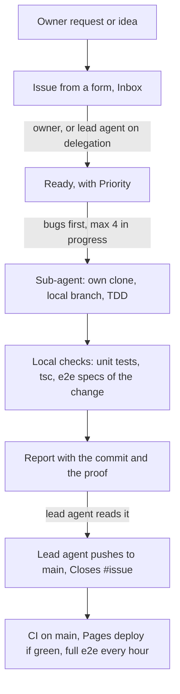
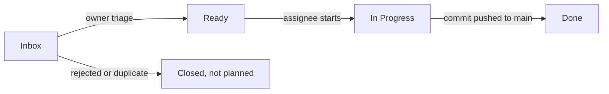

# Workflow

This is the only way work happens on AB-ALONE. It applies to humans and AI agents alike.
If a step is not written here, it does not happen. If something does not fit, open a `Decision`
issue to change this file first.

**Owners:** @TidyMaze and @Varadiell. Owners decide. They can delegate triage and merging to the
**lead agent** (the AI agent an owner drives), see section 9.

## A collaboration project

AB-ALONE is built by several people, each with their own AI agents, working at the same time on
the same repo. Nobody here is the only developer. Every action is decided and done with the other
contributors in mind:

- **Look before you act.** Check open issues, open PRs and the project board first. Someone may
  already be on it, or about to change the code you touch.
- **Decisions that affect others are shared.** A change to a rule, a spec, the CI, the branch
  protection or a shared API goes through an issue the other owner can see and answer before it
  lands. Delegation to an agent covers your own work, not the other owner's.
- **Respect others' work.** Their assigned issues and open PRs are theirs (rules 13 and 14). Their
  decisions stand until changed in a `Decision` issue.
- **Push with care.** Before pushing to `main`, check that your commit does not break or silently
  conflict with someone else's open work. If it will force them to rebase, say so in their issue.
- **Leave the shared space clean.** Do not leave servers, branches or half-done work that others
  stumble on. Close what you open.
- **Say what you do.** Comment on the issue when you start, block, change course or stop, so the
  others never have to guess.

## 0. The flow at a glance



Direct commits to `main` (decision #1433, trunk-based): no PR and no human review. The lead agent, or a release agent it names,
pushes after reading the builder's report. Quality comes from strict TDD, 100 % unit coverage of
all code, the checks before the push, and the full e2e suite that CI runs every hour when `main`
moved (#1433 replaces the "full suite locally before every merge" of decision #445). `main` red:
revert at once, then fix. Exception: Dependabot PRs still go through a PR and merge when CI is green.

## 1. The golden rules

1. **No work without a `Ready` Task or Bug.** Every commit to `main` closes at least one `task` or
   `bug` issue whose Status was `Ready` when work started. It may close several when they are
   linked (same feature or same files, rule 17), one `Closes #n` line each.
2. **No Task without a parent.** Every Task is a sub-issue of a Feature, or of an Epic for
   non-player-facing work (tooling, CI, specs).
3. **Only the lead agent, or a release agent it names, pushes to `main`.** Direct commits, no PR (decision #1433, section 6.4),
   after reading the builder's report. Sub-agents never push to `main`. Dependabot PRs still merge
   through a PR when green.
4. **Out of scope = new issue.** Anything found during a task that is not in its acceptance
   criteria becomes a new issue in `Inbox`. It never goes into the current commit.
5. **Decisions live in `Decision` issues**, never only in a PR thread, a commit or a chat.
6. **Nothing outside the repo.** If it was said in a chat or a call, write it in the right issue
   or it does not count.
7. **Finish before you start.** You may not start a new Task while one of yours is not `Done`
   (`In Progress` counts as not finished). Blocked does not free you: get it
   unblocked, or ask an owner to move it back to `Ready` and unassign you. At most **4 tasks** are
   `In Progress` at the same time across all agents, one per agent.
8. **Strict TDD, 100 % coverage.** No production code without a failing test first. Unit tests
   plus end-to-end integration tests. See section 11.
9. **This repo is public.** Never commit a secret. See section 12.
10. **Every bug goes through an issue first.** No fix, not even a one-liner, without a `bug` issue
    created from the form. See section 6.7.
11. **Priority, mainly FIFO.** Tickets are taken by importance and age (section 6.3). An open bug
    is never below `P1`.
12. **Test in a real browser regularly.** Before a push, the e2e specs of what changed run locally; CI
    runs the full Playwright suite every hour when `main` moved (decision #1433, which replaces the
    "full suite before every merge" of #445). A Chrome check before pushing a player-facing change.
    See section 11.
13. **Always assign yourself.** Before working on an issue or a PR, assign it to yourself (an agent
    assigns its driving owner and says so in a comment). Unassigned work does not exist.
14. **Hands off what others hold.** Never work on, push to, rebase or take over an issue or PR
    assigned to someone else without their explicit consent, written in the issue or PR. Let them
    finish until it is `Ready` or pushed. If it blocks you, ask in a comment and wait.
15. **No stacked branches.** A builder's local branch starts from an up-to-date `main`. Never base
    one on another unpushed branch. If your work needs another commit, wait until it is on `main`,
    then branch from `main`.
16. **Finish before piling up.** Prefer getting one commit onto `main` over holding many unpushed
    ones. Each commit that lands makes the others out of date, and each rebase means a conflict to
    resolve and checks to rerun. In practice: push a finished commit before you start another;
    do not start a new Task while a commit of yours waits on a rebase, a red check or a missing
    screenshot; work that touches the same files goes one after the other, never in parallel (the
    second branches from `main` after the first lands); the lead agent does not launch a new
    sub-agent task while it can finish or push a finished commit instead.
17. **Minimal, KISS.** Each issue, task and commit is minimal: **one thing, done well**, the simplest
    way that works. No extra feature, no refactor on the side, no option nobody asked for, no
    abstraction for later. If a request holds several things, split it into several issues.
    **Linked issues may share one commit** to go faster and avoid rebase loops: same feature, same
    files, or one needs the other (for example two settings in the same menu). Unrelated work
    never shares a commit. Anything found on the way becomes a new issue, never a bigger commit. When two
    solutions work, take the smaller one.
    **Group small open issues.** When several small open issues look doable together in one commit
    (same feature or same files, a few lines each, or the same kind of fix such as several slow
    tests), the one picking work groups them instead of doing them one by one: one commit, one
    `Closes #n` line each, every issue assigned and `In Progress` together. A duplicate is
    closed in favour of the older issue. Groups stay reviewable (rule 18); issues held by someone
    else join a group only with their holder's written consent (rule 14).
18. **Reviewable size.** A reader must be able to review any issue, Decision or spec commit in one
    sitting. A Decision asks **one question**, gives 2 or 3 options and a recommendation, and its
    body reads in about 5 minutes (roughly 500 words at most). A spec commit covers **one topic** (one
    file or one section) and stays around 300 changed lines at most. Detail that is not decided
    yet stays out, or goes in a later issue, instead of one large plan up front. Too long: split
    it before asking for a review (#361, after #313).
19. **`main` is the only long-lived branch** (decision #1433). No feature, preview or release
    branch. A builder's local branch lives a day at most and never reaches the remote. Unfinished
    work lands behind a flag that is off by default, with an issue that removes the flag.

## 2. Where things live

| Place | Holds | Never holds |
|---|---|---|
| **Discussions** | Raw ideas (`Ideas`), priority votes (`Polls`), open chat (`General`) | Work to do |
| **Issues** | Epics, Features, Tasks, Decisions: the content of each work item | Brainstorming |
| **Project** ([AB-ALONE](https://github.com/users/TidyMaze/projects/1)) | Status, priority and order of every issue: **the backlog** | Content (it stays in the issue) |
| **Commits on `main`** | The change for one Task, with `Closes #n`; the proof is in the issue | New scope, decisions |

## 3. Work item types (label)

| Type label | What it is | Size | Parent | Closed when |
|---|---|---|---|---|
| `epic` | One phase of SPEC.md (Phase 0 to 5, one per milestone), plus the `Project setup` epic for specs, workflow and tooling | Weeks | none | All its children are done |
| `feature` | Something a player can see or do. Named with a User Story: "As [role], I can [capability] because [value]". Contains US description, context, and expected outcome | Several Tasks | Epic | Owner verified every acceptance criterion |
| `task` | One commit worth of work | 1 commit, ideally under a day | Feature or Epic | Its commit is on `main` |
| `bug` | Something that works differently from its spec or acceptance criteria. Clear descriptive name, exact reproduction steps, screenshot/visual proof, and expected behaviour once fixed | 1 commit | The broken Feature, if known | Its commit is on `main` (with the reproducing test) |
| `decision` | A choice between options | n/a | optional | An owner writes the chosen option and closes it |

Parent links use GitHub **sub-issues** (issue page, "Create sub-issue" or "Add existing issue").

## 4. Status flow (`Status` field)



| Status | Meaning | Who moves it here | Gate to enter |
|---|---|---|---|
| `Inbox` | New, not triaged yet | Whoever creates the issue | Issue created from a form |
| `Ready` | Can be picked up | **Owners**, or the lead agent when an owner delegates | Definition of Ready (section 5) |
| `In Progress` | Someone is on it | The assignee | Assigned, "taking it" comment |
| `Done` | Finished | GitHub (commit with `Closes #<task>` on `main` / issue closed) | Definition of Done (section 5) |

## 5. Definitions of Ready and Done

**Feature is Ready when:**
- [ ] User Story naming: `As [role], I can [capability] because [value]`
- [ ] User Story description, context, and expected outcome are clearly written
- [ ] Acceptance criteria are a checklist an owner can verify by hand
- [ ] Linked to the spec section that defines it
- [ ] Milestone, `Priority` and parent Epic are set
- [ ] Split into at least one Task sub-issue

**Bug is Ready when:**
- [ ] Clear and descriptive title indicating what fails under what condition
- [ ] Steps to reproduce are exact and unambiguous
- [ ] Screenshot or visual recording attached (or console log / failing test output)
- [ ] Expected behaviour once fixed is documented
- [ ] Linked to the broken Feature, if known
- [ ] `Priority` is set (`P0` or `P1`)

**Task is Ready when:**
- [ ] Parent Feature or Epic is set
- [ ] One-sentence outcome and a done checklist are written
- [ ] Fits in one commit
- [ ] Open questions are answered (no linked open `Decision`)
- [ ] `Priority` is set

**Task is Done when:**
- [ ] Its commit is on `main`
- [ ] Every item of its done checklist is ticked
- [ ] CI is green (once CI exists)
- [ ] Code changes: TDD order proven (test commit before the code commit on the builder's branch, or the failing run in the report), 100 % line and region coverage, e2e test
      added or updated if a player flow changed (section 11)
- [ ] No secret in the diff (section 12)
- [ ] Specs or docs touched by the change are updated in the same commit

**Feature is Done when** all its Tasks are Done and an owner ticked every acceptance criterion,
then closed it.

## 6. The flows, step by step

### 6.1 Idea to Feature

1. Anyone posts the idea in Discussions, category **Ideas**.
2. When an owner wants it in the backlog, they create a **Feature** issue from the form, link the
   discussion, and the discussion gets a comment with the issue link. The Feature is formulated as a
   User Story: title and body follow `As [role], I can [capability] because [value]`, with context,
   user motivation, expected outcome, and acceptance criteria.
3. The Feature lands in `Inbox`.

### 6.2 Triage (owners, or the lead agent on delegation)

An owner triages, or tells the lead agent to (for example "take the decisions"). Every decision
the lead agent takes on delegation is written as a comment in the issue. For each `Inbox` item,
the triager does exactly one of:
- **Accept:** complete it to the Definition of Ready, create its Task sub-issues, set `Priority`,
  move it to `Ready`.
- **Ask:** comment what is missing, keep it in `Inbox`.
- **Reject:** close as "not planned" with one line of why.

### 6.3 Doing a Task

1. Pick the next item by priority, mainly FIFO (owner, 2026-11-01). `P0` and a red `main` come
   first. Then the oldest `Ready` issue by creation date, where a bug or a `P1` counts as 3 days
   older and a `P3` as 3 days younger. You may skip one only with a comment saying why. Bugs follow
   the same steps below, with "Task" meaning "Task or Bug".
2. Assign yourself, comment `taking it` in the same step as starting work, move it to `In Progress`. Answer every ping
   (`@mention`, assignment, review request) on that issue or PR, in the same session (AGENTS rule 17).
   **WIP limit: one unfinished Task per contributor, at most 4 in progress overall** (rule 7; an
   agent counts as a contributor).
3. Branch locally from an up-to-date `main`: `<issue number>-<short-slug>`, for example `23-board-model`.
   The branch lives a day at most and is never pushed (rule 19).
4. Blocked: add the `blocked` label, comment what blocks and @mention who can unblock. Keep the
   Status.
5. Scope changes mid-task: stop, comment on the Task, wait for an owner to update the Task before
   continuing.

### 6.4 Push to main

Decision #1433: no PR, direct commits to `main`. Dependabot PRs are the exception: they merge through
a PR when CI is green.

1. The builder (sub-agent) commits on its local branch and reports the commit: what changed, the
   checks it ran, the proof. It never pushes to `main`.
2. **Pre-push checks**, all green: `bun run test`, `bunx tsc --noEmit` and the e2e specs of what
   changed (section 13). Rust changes: `scripts/verify.sh`. The full e2e suite is not run by hand:
   CI runs it every hour when `main` moved.
3. **Pull and rebase first**: `git pull --rebase origin main`. After a rebase without conflict,
   rerun only `bun run test` and `bunx tsc --noEmit` (rebuild the WASM first if `crates/` changed,
   section 13). A rebase with a conflict reruns every check.
4. **The lead agent, or a release agent it names, pushes** to `main`, after reading the report. An owner may push too. The commit
   message says `Closes #<task>` (one line per issue it closes, rule 17), or `Refs #<issue>` for a
   slice (AGENTS rule 12).
5. **Proof goes in a comment on the issue**: the tests that ran, a screenshot, what was not done.
   **A change to the UI MUST have a screenshot** in that comment (before and after when it changes
   an existing screen). Take it with Playwright (`page.screenshot`) or in Chrome. Push the image to
   the `pr-screenshots` branch (`pr-screenshots/<issue>-<name>.png`) and link it:
   ``.
   No UI change: write "no UI change". No screenshot, no push.
   The e2e specs save their pictures (`test-results/*.png`, `MODE_SWITCH_SHOT`...) only when `E2E_SHOTS=1`
   is set, as each one costs a frame of software WebGL on the CI runner (`client/e2e/shot.ts`).
6. **CI runs on every push to `main`** (the check `rust`). Pages deploys only after a green CI.
   **`main` red: revert at once, then fix.** No discussion first; the fix is a new commit with its
   own test.
7. Docs-only commits (`**.md`, `docs/**`) skip CI. The lead agent, or a release agent it names, pushes them after reading the diff.
8. A comment that adds scope gets the answer "new issue #N" and goes to `Inbox`.
9. Work that cannot land whole goes behind a flag off by default (rule 19), for example the neon
   design behind `?look=neon` (#1424).

### 6.5 Decision

1. Anyone opens a **Decision** issue from the form: context, options, recommendation.
2. Discussion happens in its comments. Agents may recommend.
3. An owner closes it with the final comment `Decided: <option>`.
4. If a spec changes, a Task "Update spec for #N" is created and goes through the normal flow.

### 6.6 Priority vote

1. An owner opens a Discussion in **Polls**: one comment per candidate issue.
2. Everyone votes with a 👍 on each comment they want. No limit.
3. When both owners voted, an owner copies the counts into the `Votes` field, sets `Priority`
   (`P0` now, `P1` next, `P2` later, `P3` someday), labels the top ten `top10`, and closes the
   discussion.

### 6.7 Bug

1. Whoever finds a bug (human, agent, CI) opens a **Bug** issue from the
   form **before touching any code**:
   - **Clear name**: concise title describing what fails under what condition.
   - **Steps to reproduce**: exact numbered sequence to trigger the issue reliably.
   - **Screenshot or visual recording**: proof of the broken state (or terminal/console log if non-visual).
   - **Expected behaviour once fixed**: explicit description of how the system should behave after the fix.
   - **Environment**: browser, OS and commit.
   A bug found during another task is filed too, never fixed inside that task's commit.
2. It lands in `Inbox`. An owner triages it within the next triage: confirm, set `Priority`
   (**`P0` if it breaks a game or loses data, never lower than `P1`**), link the broken Feature,
   move it to `Ready`. A bug that is not reproducible is closed with a comment.
3. The fix follows 6.3 and 6.4. The first commit is a test that reproduces the bug and fails
   (unit test, plus an e2e test if a player saw it). Then the fix. The commit says `Closes #<bug>`.
4. Bugs are picked before tasks (rule 11).

## 7. Project fields

| Field | Values | Set by |
|---|---|---|
| `Status` | `Inbox`, `Ready`, `In Progress`, `Done` | Section 4 |
| `Priority` | `P0` to `P3` | Owners, or the lead agent on delegation |
| `Votes` | Number of 👍 in the last vote | Owners only |
| Milestone | `Phase 0` to `Phase 5` | Issue creator, checked at triage |

The project holds **issues only**: no draft items, no project-only tasks. Every issue is added to the project when created, so there is one item per piece of work and no duplicate to keep in sync.

## 8. Labels

| Label | Meaning |
|---|---|
| `epic`, `feature`, `task`, `bug`, `decision` | Item type (section 3), set by the issue form. Exactly one per issue. In the project, filter with `label:bug` etc. |
| `engine`, `client`, `network`, `design`, `spec` | Area |
| `blocked` | Waiting on someone, see the last comment |
| `top10` | Won the latest priority vote |
| `security` | Security incident or hardening (section 12) |

## 9. AI agents

Two roles:

| Role | Does | Never does |
|---|---|---|
| **Lead agent** (driven by an owner) | Writes issues, triages and sets `Priority` when an owner delegates, starts up to 4 sub-agents in parallel, checks their reports (tests, a real browser run for player-facing changes), pushes to `main` (section 6.4) or names a release agent that does, reverts a red `main` | Closes a `Decision` without an owner, starts a 5th task, pushes a red or unchecked commit |
| **Sub-agent** | One Task: own clone, own local branch, TDD, local checks, reports the commit on its branch, rebases when asked | Pushes to `main` (unless it is the release agent the lead agent named), triages, sets `Priority`, works outside its Task |

Every agent follows the rules above, plus:
- One agent, one clone, one local branch, one `In Progress` Task.
- Agents talk to each other only through issue comments.
- An agent kills the dev servers it started when it finishes (stray servers loaded the machine and
  made e2e runs flaky).
- The report and the issue comment say which agent wrote the commit and which owner drives it.

## 10. Forbidden

- A commit to `main` without `Closes #<task>` or `Refs #<issue>`.
- Working on an issue that is not `Ready`.
- A sub-agent pushing to `main`, or any push to `main` with a red check or without the report read.
- A feature, preview or release branch on the remote.
- Adding something to a commit that is not in its Task.
- Deciding in a commit message or a chat.
- Blank issues: always use a form.
- Working on an issue or PR without being assigned to it.
- Touching an issue or PR assigned to someone else without their written consent.
- A branch based on another unpushed branch.
- Pushing to `main` unfinished, in conflict or out of date: pull and rebase first, or keep it local.
- Fixing a bug without a `bug` issue, or inside another task's commit.
- Starting a task while a `Ready` bug of the same or higher priority is waiting.

## 11. Testing: strict TDD, 100 % coverage

Applies to every line of production code (engine, client, networking, tools).

**The cycle, for every behaviour:**
1. **Red:** write one failing test that describes the behaviour. Run it, see it fail for the
   right reason.
2. **Green:** write the minimum production code that makes it pass. Run the whole suite.
3. **Refactor:** clean up with all tests green. No new behaviour in this step.

**Proof of the order:** the test commit comes before the implementation commit on the builder's local
branch (for example `test: sumito 3v2 pushes` then `feat: sumito`), or the report shows the failing
run. The lead agent checks it and may run the test commit alone to see it fail. Only the final
commit reaches `main`, so the proof is in the report and the issue comment.

**Required test levels:**

| Level | What | Where |
|---|---|---|
| Unit | Every function and branch: rules engine, input logic, protocol messages | Next to the code |
| Property | Engine invariants (marble conservation, every generated move is legal, perft counts) | Engine crate |
| Integration | Engine through its WASM bridge, two peers exchanging moves in-process | Per crate / package |
| End-to-end | Real browser: play a full local game, play an online game between two browser tabs, at least one boss encounter once it exists | E2E suite |

**Coverage gate:** unit tests cover **100 % of all the code** (decision #445): every client source
file (`client/src/**`, `client/scripts/**`, `main.ts` included), the MCP package (`mcp/src/**`,
`main.ts` included) and the Rust crates. Rust: 100 % of lines and regions (not branches, owner
decision), enforced by `scripts/verify.sh` locally and by the CI coverage job on main after the push.
Below 100 % fails the build. Commands: section 13. The client JS coverage (`bun run test`, vitest,
100 % thresholds) and `tsc` run in the CI check `rust` on every push to `main` and Dependabot PR (#409). An exclusion
needs a one-line comment saying why, and the reviewer must accept it (generated code,
`unreachable!()`).

**`main.ts` in vitest (#447):** `client/src/test/harness.ts` runs the whole page under jsdom. A test file starts
with `// @vitest-environment jsdom`, then `const game = await boot('?bot=off')` loads `index.html` and a fresh
`main.ts` on the real wasm engine (build it first, section 13). The renderer, textures, canvas, the web fonts,
matchMedia, IndexedDB (fake-indexeddb), the bot workers (in-process), the Trystero transport (`game.peer()` is the
other end of a `localPair`) and the clock are stubbed; `boot` options set `webdriver`, `reducedMotion`, a fake
`audio` context, the `indexedDB` to share between two boots (a reload) and `fonts`, the `document.fonts.load` to
use. Drive it like an e2e test: `game.click(q, r)`, the page hooks through `game.hook('__legal')`,
`game.openSettings()`, `game.openModes()`, `game.hud()`, `game.turn()`, `game.frame(ms)` to run the animation loop,
`await game.settle()` for the bot replies and the saves. Everything is undone when the test ends. Example:
`client/src/main.test.ts`.

**Bugs:** a bug fix starts with a test that reproduces the bug and fails (section 6.7).

**Browser testing, regularly (Chrome + Playwright):**

| When | What | Who |
|---|---|---|
| Every push | The e2e specs of what changed, run locally before the push (section 13) | Builder |
| Every hour | The full Playwright e2e suite on Chromium, in CI, when `main` moved (`.github/workflows/e2e-hourly.yml`, decision #1433, which replaces the "full suite before every merge" of #445). A red spec gets a `bug` issue the same day (AGENTS rule 14) | CI |
| Every e2e test | Passes in **under 15 s** locally, and a test that runs longer **fails**: the Playwright test timeout is 15 s (45 s on CI, whose runners have no GPU, #1436) (#349). A slower test is made cheaper (reach the state through a test hook instead of clicking through, smaller setup) or its logic moves to a fast unit test, keeping one thin e2e for the browser wiring (#349). **A test loads the full game state it needs** (a position, a boss phase, a finished game) through one test hook built on the game file import (#219) instead of replaying steps that other e2e tests already cover | Author |
| Before pushing a player-facing change | Open the build in a real browser, play the changed flow, note the result in the issue comment | The lead agent (Playwright) or an owner |
| Once per milestone | Full manual playthrough in Chrome of everything shipped so far, findings filed as `bug` issues | An owner |

Specs and docs commits have no code, so this section does not apply to them.

## 12. Public repo: no secrets, ever

This repository is **public**. Everything pushed is readable by anyone, forever (git history and
forks keep it even after a revert).

- Never commit keys, tokens, passwords, private URLs, `.env` files, certificates or personal data.
- Configuration that needs a secret reads it from an environment variable or a GitHub Actions
  secret. Commit a `.env.example` with fake values only.
- GitHub secret scanning and push protection are on. If push protection blocks you, remove the
  secret from your commits. Never bypass the block.
- **A secret was pushed anyway:** revoke or rotate it at its provider first (removing it from git
  is not enough), then tell an owner in a `Decision` issue labelled `security` without pasting the
  secret.
- Agents: never print a secret in an issue, PR, log or test fixture.

## 13. Local setup and checks

**A clone made before the rename to Edgefall (#1650)** points its remote at the new name once:
`git remote set-url origin git@github.com:TidyMaze/edgefall.git`. GitHub redirects the old name meanwhile.

**Before every push to `main`:** run `scripts/verify.sh` from the repo root when Rust changed, except
for a push that only rebases on `main` without conflict (section 6.4). It runs the CI checks locally:

- `cargo fmt --all --check`
- `cargo clippy --all-targets --locked -- -D warnings`
- `cargo llvm-cov --workspace --locked --fail-under-lines 100 --fail-under-regions 100`

**What CI runs** (`.github/workflows/ci.yml`):

- On every push to `main` and on every Dependabot PR (not on drafts), four jobs side by
  side: `cargo` (fmt, clippy, `cargo test --all --locked`, optimised by `[profile.test]` in
  `Cargo.toml`), `client` (`bun run test`, vitest, 100 % coverage thresholds), `build`
  (`bunx tsc --noEmit`, the production build and its size budget) and `mcp`, the last three on a
  cached WASM build. The required `rust` check (#409) waits for the four and fails unless every
  one succeeded. A draft PR shows the `rust` check as skipped.
- On push to `main`: the Rust job always runs. The coverage gate runs only when
  `crates/`, `Cargo.*` or `ci.yml` changed (job `changes`: it diffs against the last successful CI
  run on `main`, so a cancelled run never hides its commits; a dispatch runs everything). A
  new push to `main` still cancels the push run in progress, never a dispatched run (the group has
  the event name).
- **e2e only on a dispatch**, never on a PR or a push. `.github/workflows/e2e-hourly.yml` dispatches
  about every hour (on a schedule, and after each green push CI) when the head of `main` differs
  from the last dispatched run, which started over 60 minutes ago (decision #1433,
  which replaces the "full suite before every merge" of #445). To run it by hand, for example to
  check a flake on a clean runner: `gh workflow run ci.yml --ref main`. The WASM package is
  built once (job `wasm`, cached) and shared as an artifact, then the e2e suite runs in 4 shards,
  one runner and one worker each (#257, #258). The tests are dealt to the shards back and forth, so
  the slow ones spread over all four (`client/scripts/shard-reporter.ts`, #333). A failed shard
  uploads its own `playwright-report-<n>` artifact. On CI the browser window is 960x540, not
  1280x720: software WebGL cost follows the pixels.

- **Pages deploy** (`.github/workflows/pages.yml`): runs after a CI run on `main` that ended green
  (`workflow_run`, #1433). It builds the commit CI tested. A test-only commit redeploys too, so a
  cancelled CI run never loses a deploy; the `pages` concurrency group keeps the newest (#1267). To redeploy the head of `main` by hand (for
  example after a failed run): `gh workflow run pages.yml --ref main`.

**WASM build:** the client loads the engine from `crates/edgefall-wasm/pkg`, which is git-ignored.
After pulling main, rebuild it from the repo root:

```
wasm-pack build crates/edgefall-wasm --target web
```

`bun run dev` runs the same build first (`bun run wasm`, in `client/`). Run it yourself when you
start vite directly, or when the pkg looks stale.

**Client tooling: bun** (decision #243). Install [bun](https://bun.sh), then run `bun install` in
`client/`. Scripts run with `bun run <script>`, one-off tools with `bunx`. Unit tests are
`bun run test` (vitest), never `bun test`, which is bun's own test runner. Node 22 must be
installed too: vite, vitest and Playwright still run on it. The bun version is pinned in
`client/package.json` (`packageManager`). Add a dependency with `bun add <pkg>@<exact version>`
(`-d` for a dev dependency), never with npm: each package has one lockfile, its `bun.lock`
(`client/`, `mcp/`).

**MCP server (`mcp/`, #252):** its own bun package, run when you touch `mcp/`, the engine API it
uses, or the client modules its online rooms import (`client/src/session.ts`, `moverecord.ts`, `p2p.ts` and
what they import, #254). Not in CI. It resolves Trystero from `client/node_modules`, so run `bun install` in
`client/` first. From `mcp/`, after `bun install`:

- `bun run test`: builds the Node target of the engine into `mcp/engine/` (git-ignored), then
  vitest with coverage thresholds of 100 % (lines, branches, functions, statements) on all of `mcp/src/`,
  the stdio entry point `src/main.ts` included (its test swaps stdio for an in-memory pair).
- `bunx tsc --noEmit`.
- `bun run e2e`: a scripted MCP client starts the server over stdio and plays a full game, then two
  servers play each other over real WebRTC: it needs the public Nostr relays (internet).

**Homebrew Rust without rustup:** set these before the WASM build or the checks. `wasm-ld` must be
on PATH (Homebrew llvm is keg-only, so add `$(brew --prefix llvm)/bin` to PATH).

```
export CARGO_TARGET_WASM32_UNKNOWN_UNKNOWN_LINKER=wasm-ld
export LLVM_COV="$(brew --prefix llvm)/bin/llvm-cov"
export LLVM_PROFDATA="$(brew --prefix llvm)/bin/llvm-profdata"
```

**While developing, run the smallest check that proves the change** (save CPU and time):
only the unit test file you touch with scoped coverage (`bun run test:scoped <file>` for instant 100 % coverage check, or `bun run test:unit src/<file>.test.ts` without coverage), instant layout geometry check (`bun run layout:check`), only the e2e spec you
touch (`bun run e2e:layout` for UI layout, or `bunx playwright test e2e/<spec>.spec.ts`, one worker, `-g "<title>"` for one test),
`bunx tsc --noEmit` when you change client types, `cargo test -p <crate> <name>` for one Rust test.
**When:** while developing, run only the unit file you touch. Before the push, run the e2e specs of
what changed, and write the result in the issue comment. The full suite is not run by hand: CI runs
it every hour when `main` moved (decision #1433). A boot or renderer change may justify a full local
run first, the lead agent decides. No full `scripts/verify.sh` while developing and no `--repeat-each` beyond what a
flake needs.

**e2e:** from `client/`, run `bun run e2e` (Chromium project). Playwright builds the page
(`vite build --mode e2e`, 2 to 3 s, into `client/dist-e2e/`) and serves it with `vite preview`: most specs
run on that build, which is lighter than the dev server (it transforms every module again on each page
load, #1289). Locally it runs 4 workers at most, so the machine stays usable. Playwright also starts the
dev server itself, with `--mode e2e`, for the specs that test the dev server (`dev-server`, `lights-panel`,
the dev case of `offline`, they read `E2E_DEV_URL`): that server does not watch files, so a wasm rebuild or an edit during a
run never reloads a page under test (bug #185). `E2E_SERVER=dev` runs every spec on the dev server, for a spec being written. It also serves the page without its Google Fonts links, so a
network outage never holds a page load (bug #585). Start a new run to test a change.

- Visuals are judged by the art director on captures: no contrast test, in e2e or in unit tests (owner, 2026-11-07). A test that passes on its one
  retry shows as flaky, not red; waits on a state get 10 s, a test still fails at 15 s (#1383); on CI 30 s and 45 s (#1436).
- The port comes from `E2E_PORT`, a random free one when it is not set; the dev server is always started fresh, never reused (#1436). To pin it:

  ```
  E2E_PORT=$(python3 -c 'import socket; s=socket.socket(); s.bind(("", 0)); print(s.getsockname()[1])') bun run e2e
  ```

- An existing server on that port is reused. Kill only the server you started: save its PID
  (`echo $! > pid`) and `kill` that PID. Never `pkill -f`.
- The offline test (`e2e/offline.spec.ts`) needs the production build: Playwright also runs
  `vite build` then `vite preview` on a random port (`E2E_PREVIEW_PORT`, never reused) and stops it
  at the end. Every other spec runs with service workers blocked (docs/specs/tech.md section 9.1).
  It answers the Google Fonts requests itself, so it too never waits on the network (bug #649).
- The dispatched CI run sets `E2E_SKIP_WASM_BUILD=1` so the dev server skips the wasm rebuild (the `wasm` job built it). Locally, leave it unset.
- Screenshots go to `client/test-results/`, which is git-ignored. Do not commit them.
- On a Mac, the local Chromium draws on the GPU, still with the WebGL2 backend (WebGPU is turned off). CI runners
  have no GPU and draw with SwiftShader, whose first draw of a page blocks it for seconds (bug #563).

**WebGPU check (#1023):** `bun run e2e:webgpu`, from `client/`. It runs the Open world on a real WebGPU adapter
(`client/e2e-webgpu/`, config `client/playwright.webgpu.config.ts`): Chromium's new headless mode with
`--enable-unsafe-webgpu` (on a Mac, the Metal adapter). It enters the world, walks, zooms to the widest view, turns the
camera and leaves twice, then walks and zooms 30 times, waiting for a submitted frame each time, and fails on any console
error, uncaught exception or failed request, any device `uncapturederror` or `lost`, and any validation error: every queue
submit (one drawn frame) runs in `pushErrorScope("validation")`, which turns "used in submit while destroyed" into an error
the test reads. Over 25 entries and exits the geometries three holds stay flat (slack 4); the textures check is an expected
failure until bug #1258 is fixed. Proof run (2026-11-01): the check goes red when a retired buffer is freed at once and the
meshes share a geometry (mutation of `retire` and `replace`); it stays green when only the geometry is shared, or only the
free is early (three recreates the buffers at the next draw), so a headless run does not catch everything. Before merging an
Open world mesh or buffer change, run the game once in headed Chrome and check the console is empty. The default suite cannot see the
WebGPU errors of #1015 and #1017: it runs the WebGL2 fallback. The check is not in the default run (`bun run e2e`, the
CI e2e shards) and not in CI: CI runners have no GPU, so it would skip there, and a dispatch would not change that.
Run it by hand before a change to the Open world's buffers, geometries or materials. Without a real adapter (no GPU, or
the headless shell's SwiftShader software adapter) the test skips and reports it. The headless shell is not used.
