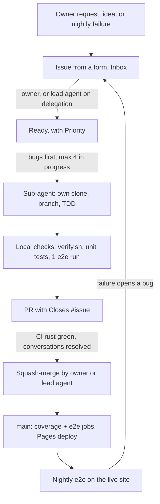
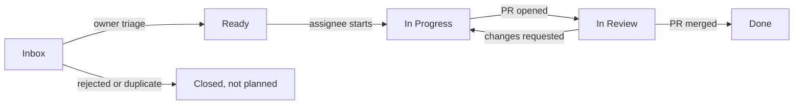

# Workflow

This is the only way work happens on AB-ALONE. It applies to humans and AI agents alike.
If a step is not written here, it does not happen. If something does not fit, open a `Decision`
issue to change this file first.

**Owners:** @TidyMaze and @Varadiell. Owners decide. They can delegate triage and merging to the
**lead agent** (the AI agent an owner drives), see section 9.

## 0. The flow at a glance



No human review is required: a PR merges as soon as the required CI check `rust` is green and every
conversation is resolved. Quality comes from strict TDD, 100 % coverage, e2e tests and the nightly
run.

## 1. The golden rules

1. **No work without a `Ready` Task or Bug.** Every PR closes exactly one `task` or `bug` issue
   whose Status was `Ready` when work started.
2. **No Task without a parent.** Every Task is a sub-issue of a Feature, or of an Epic for
   non-player-facing work (tooling, CI, specs).
3. **No direct push to `main`.** Everything goes through a PR. It merges once the CI check `rust`
   is green and conversations are resolved, with no review required (section 6.4).
4. **Out of scope = new issue.** Anything found during a task that is not in its acceptance
   criteria becomes a new issue in `Inbox`. It never goes into the current PR.
5. **Decisions live in `Decision` issues**, never only in a PR thread, a commit or a chat.
6. **Nothing outside the repo.** If it was said in a chat or a call, write it in the right issue
   or it does not count.
7. **Finish before you start.** You may not start a new Task while one of yours is not `Done`
   (`In Progress` or `In Review` both count as not finished). Blocked does not free you: get it
   unblocked, or ask an owner to move it back to `Ready` and unassign you. At most **4 tasks** are
   `In Progress` at the same time across all agents, one per agent.
8. **Strict TDD, 100 % coverage.** No production code without a failing test first. Unit tests
   plus end-to-end integration tests. See section 11.
9. **This repo is public.** Never commit a secret. See section 12.
10. **Every bug goes through an issue first.** No fix, not even a one-liner, without a `bug` issue
    created from the form. See section 6.7.
11. **Bugs before features.** A `Ready` bug is always picked before any `Ready` task of the same
    or lower priority, and an open bug is never below `P1`.
12. **Test in a real browser regularly.** Playwright on every PR, a scheduled run against the live
    site, and a manual Chrome check before merging a player-facing change. See section 11.

## 2. Where things live

| Place | Holds | Never holds |
|---|---|---|
| **Discussions** | Raw ideas (`Ideas`), priority votes (`Polls`), open chat (`General`) | Work to do |
| **Issues** | Epics, Features, Tasks, Decisions: the content of each work item | Brainstorming |
| **Project** ([AB-ALONE](https://github.com/users/TidyMaze/projects/1)) | Status, priority and order of every issue: **the backlog** | Content (it stays in the issue) |
| **Pull requests** | The change for one Task, and its review | New scope, decisions |

## 3. Work item types (label)

| Type label | What it is | Size | Parent | Closed when |
|---|---|---|---|---|
| `epic` | One phase of SPEC.md (Phase 0 to 5, one per milestone), plus the `Project setup` epic for specs, workflow and tooling | Weeks | none | All its children are done |
| `feature` | Something a player can see or do | Several Tasks | Epic | Owner verified every acceptance criterion |
| `task` | One PR worth of work | 1 PR, ideally under a day | Feature or Epic | Its PR is merged |
| `bug` | Something that works differently from its spec or acceptance criteria | 1 PR | The broken Feature, if known | Its PR is merged (with the reproducing test) |
| `decision` | A choice between options | n/a | optional | An owner writes the chosen option and closes it |

Parent links use GitHub **sub-issues** (issue page, "Create sub-issue" or "Add existing issue").

## 4. Status flow (`Status` field)



| Status | Meaning | Who moves it here | Gate to enter |
|---|---|---|---|
| `Inbox` | New, not triaged yet | Whoever creates the issue | Issue created from a form |
| `Ready` | Can be picked up | **Owners**, or the lead agent when an owner delegates | Definition of Ready (section 5) |
| `In Progress` | Someone is on it | The assignee | Assigned, "taking it" comment |
| `In Review` | PR open | The assignee | PR open with `Closes #<task>` |
| `Done` | Finished | GitHub (PR merged / issue closed) | Definition of Done (section 5) |

## 5. Definitions of Ready and Done

**Feature is Ready when:**
- [ ] Problem and player-facing outcome are written
- [ ] Acceptance criteria are a checklist an owner can verify by hand
- [ ] Linked to the spec section that defines it
- [ ] Milestone, `Priority` and parent Epic are set
- [ ] Split into at least one Task sub-issue

**Task is Ready when:**
- [ ] Parent Feature or Epic is set
- [ ] One-sentence outcome and a done checklist are written
- [ ] Fits in one PR
- [ ] Open questions are answered (no linked open `Decision`)
- [ ] `Priority` is set

**Task is Done when:**
- [ ] Its PR is merged into `main`
- [ ] Every item of its done checklist is ticked
- [ ] CI is green (once CI exists)
- [ ] Code changes: TDD commit order visible in the PR, 100 % line and region coverage, e2e test
      added or updated if a player flow changed (section 11)
- [ ] No secret in the diff (section 12)
- [ ] Specs or docs touched by the change are updated in the same PR

**Feature is Done when** all its Tasks are Done and an owner ticked every acceptance criterion,
then closed it.

## 6. The flows, step by step

### 6.1 Idea to Feature

1. Anyone posts the idea in Discussions, category **Ideas**.
2. When an owner wants it in the backlog, they create a **Feature** issue from the form, link the
   discussion, and the discussion gets a comment with the issue link.
3. The Feature lands in `Inbox`.

### 6.2 Triage (owners, or the lead agent on delegation)

An owner triages, or tells the lead agent to (for example "take the decisions"). Every decision
the lead agent takes on delegation is written as a comment in the issue. For each `Inbox` item,
the triager does exactly one of:
- **Accept:** complete it to the Definition of Ready, create its Task sub-issues, set `Priority`,
  move it to `Ready`.
- **Ask:** comment what is missing, keep it in `Inbox`.
- **Reject:** close as "not planned" with one line of why.

### 6.3 Doing a Task

1. Pick the next item in this order: **`Ready` bugs first** (highest `Priority` first), then
   `Ready` tasks by `Priority`. You may skip one only with a comment saying why. Bugs follow the
   same steps below, with "Task" meaning "Task or Bug".
2. Assign yourself, comment `taking it`, move it to `In Progress`.
   **WIP limit: one unfinished Task per contributor, at most 4 in progress overall** (rule 7; an
   agent counts as a contributor).
3. Branch from `main`: `<issue number>-<short-slug>`, for example `23-board-model`.
4. Blocked: add the `blocked` label, comment what blocks and @mention who can unblock. Keep the
   Status.
5. Scope changes mid-task: stop, comment on the Task, wait for an owner to update the Task before
   continuing.

### 6.4 Pull request

1. Open the PR from the template. The body contains exactly one `Closes #<task>`.
2. Move the Task to `In Review`.
3. Review is **optional**. Anyone may comment; the author answers every comment in its thread and
   pushes fixes to the same branch.
4. A comment that adds scope gets the answer "new issue #N" and goes to `Inbox`.
5. **Merge gate.** A PR is merged into `main` only when all of these hold:
   - [ ] Checked locally: `scripts/verify.sh` green, unit tests green, one full e2e run green
   - [ ] CI: the required check `rust` is green (enforced by branch protection, 0 approvals needed)
   - [ ] Every conversation resolved (enforced by branch protection)
   - [ ] Up to date: rebased on `main`, no conflict
6. As soon as the gate passes, **an owner or the lead agent squash-merges into `main`**. Sub-agents
   never merge. A green PR is never left open: the Task is not `Done` until it is merged. GitHub
   closes the Task, the project sets `Done`, the branch is deleted.
7. Docs-only PRs (`**.md`, `docs/**`) skip CI, so the `rust` check never reports on them. An owner
   or the lead agent merges them with the admin bypass after reading the diff.

### 6.5 Decision

1. Anyone opens a **Decision** issue from the form: context, options, recommendation.
2. Discussion happens in its comments. Agents may recommend.
3. An owner closes it with the final comment `Decided: <option>`.
4. If a spec changes, a Task "Update spec for #N" is created and goes through the normal flow.

### 6.6 Priority vote

1. An owner opens a Discussion in **Polls**: one comment per candidate issue.
2. Everyone votes with a 👍 on each comment they want. No limit.
3. When both owners voted, an owner copies the counts into the `Votes` field, sets `Priority`
   (`P0` now, `P1` next, `P2` later, `P3` someday), labels the top ten `top10`, and closes the
   discussion.

### 6.7 Bug

1. Whoever finds a bug (human, agent, CI, a scheduled browser run) opens a **Bug** issue from the
   form **before touching any code**: steps to reproduce, expected, actual, browser and commit.
   A bug found during another task is filed too, never fixed inside that task's PR.
2. It lands in `Inbox`. An owner triages it within the next triage: confirm, set `Priority`
   (**`P0` if it breaks a game or loses data, never lower than `P1`**), link the broken Feature,
   move it to `Ready`. A bug that is not reproducible is closed with a comment.
3. The fix follows 6.3 and 6.4. The first commit is a test that reproduces the bug and fails
   (unit test, plus an e2e test if a player saw it). Then the fix. The PR says `Closes #<bug>`.
4. Bugs are picked before tasks (rule 11).

## 7. Project fields

| Field | Values | Set by |
|---|---|---|
| `Status` | `Inbox`, `Ready`, `In Progress`, `In Review`, `Done` | Section 4 |
| `Priority` | `P0` to `P3` | Owners, or the lead agent on delegation |
| `Votes` | Number of 👍 in the last vote | Owners only |
| Milestone | `Phase 0` to `Phase 5` | Issue creator, checked at triage |

The project holds **issues only**: no draft items, no project-only tasks. Every issue is added to the project when created, so there is one item per piece of work and no duplicate to keep in sync.

## 8. Labels

| Label | Meaning |
|---|---|
| `epic`, `feature`, `task`, `bug`, `decision` | Item type (section 3), set by the issue form. Exactly one per issue. In the project, filter with `label:bug` etc. |
| `engine`, `client`, `network`, `design`, `spec` | Area |
| `blocked` | Waiting on someone, see the last comment |
| `top10` | Won the latest priority vote |
| `security` | Security incident or hardening (section 12) |

## 9. AI agents

Two roles:

| Role | Does | Never does |
|---|---|---|
| **Lead agent** (driven by an owner) | Writes issues, triages and sets `Priority` when an owner delegates, starts up to 4 sub-agents in parallel, checks their reports (CI, tests, a real browser run for player-facing changes), merges green PRs | Closes a `Decision` without an owner, starts a 5th task, merges a red PR |
| **Sub-agent** | One Task: own clone, own branch, TDD, local checks, opens the PR, rebases when asked | Merges, triages, sets `Priority`, works outside its Task |

Every agent follows the rules above, plus:
- One agent, one clone, one branch, one `In Progress` Task.
- Agents talk to each other only through issue comments and PR reviews.
- An agent kills the dev servers it started when it finishes (stray servers loaded the machine and
  made e2e runs flaky).
- The PR body says which agent wrote it and which owner drives it.

## 10. Forbidden

- A PR without `Closes #<task>`, or closing more than one issue.
- Working on an issue that is not `Ready`.
- Pushing to `main`.
- Adding something to a PR that is not in its Task.
- Deciding in a PR thread, a commit message or a chat.
- Blank issues: always use a form.
- Fixing a bug without a `bug` issue, or inside another task's PR.
- Starting a task while a `Ready` bug of the same or higher priority is waiting.

## 11. Testing: strict TDD, 100 % coverage

Applies to every line of production code (engine, client, networking, tools).

**The cycle, for every behaviour:**
1. **Red:** write one failing test that describes the behaviour. Run it, see it fail for the
   right reason.
2. **Green:** write the minimum production code that makes it pass. Run the whole suite.
3. **Refactor:** clean up with all tests green. No new behaviour in this step.

**Proof in the PR:** the test commit comes before the implementation commit (for example
`test: sumito 3v2 pushes` then `feat: sumito`). The reviewer checks the commit order and may run
the test commit alone to see it fail. The PR is squash-merged, the order lives in the PR.

**Required test levels:**

| Level | What | Where |
|---|---|---|
| Unit | Every function and branch: rules engine, input logic, protocol messages | Next to the code |
| Property | Engine invariants (marble conservation, every generated move is legal, perft counts) | Engine crate |
| Integration | Engine through its WASM bridge, two peers exchanging moves in-process | Per crate / package |
| End-to-end | Real browser: play a full local game, play an online game between two browser tabs, at least one boss encounter once it exists | E2E suite |

**Coverage gate:** 100 % of lines and regions for Rust (not branches, owner decision), enforced by
`scripts/verify.sh` locally and by the CI coverage job on main after merge. Below 100 % fails the
build. Commands: section 13. The client JS coverage (`npm test`, vitest) is not in CI. An exclusion
needs a one-line comment saying why, and the reviewer must accept it (generated code,
`unreachable!()`).

**Bugs:** a bug fix starts with a test that reproduces the bug and fails (section 6.7).

**Browser testing, regularly (Chrome + Playwright):**

| When | What | Who |
|---|---|---|
| Every PR | Playwright e2e suite on Chromium, run locally once with `npm run e2e` (section 13). CI runs it on main after merge, not on PRs | Author |
| Every night | Playwright suite against the live GitHub Pages site (scheduled workflow). A failure opens a `bug` issue automatically | CI |
| Before merging a player-facing PR | Open the PR build in a real browser, play the changed flow, note the result in the PR | The lead agent (Playwright) or an owner |
| Once per milestone | Full manual playthrough in Chrome of everything shipped so far, findings filed as `bug` issues | An owner |

Specs and docs PRs have no code, so this section does not apply to them.

## 12. Public repo: no secrets, ever

This repository is **public**. Everything pushed is readable by anyone, forever (git history and
forks keep it even after a revert).

- Never commit keys, tokens, passwords, private URLs, `.env` files, certificates or personal data.
- Configuration that needs a secret reads it from an environment variable or a GitHub Actions
  secret. Commit a `.env.example` with fake values only.
- GitHub secret scanning and push protection are on. If push protection blocks you, remove the
  secret from your commits. Never bypass the block.
- **A secret was pushed anyway:** revoke or rotate it at its provider first (removing it from git
  is not enough), then tell an owner in a `Decision` issue labelled `security` without pasting the
  secret.
- Agents: never print a secret in an issue, PR, log or test fixture.

## 13. Local setup and checks

**Before every push:** run `scripts/verify.sh` from the repo root. It runs the CI checks locally:

- `cargo fmt --all --check`
- `cargo clippy --all-targets --locked -- -D warnings`
- `cargo llvm-cov --workspace --locked --fail-under-lines 100 --fail-under-regions 100`

**What CI runs** (`.github/workflows/ci.yml`):

- On every PR: fmt, clippy and `cargo test --all --locked`.
- On push to main (after merge): the same Rust job, the coverage gate and the e2e job.

**WASM build:** the client loads the engine from `crates/abalone-wasm/pkg`, which is git-ignored.
After pulling main, rebuild it from the repo root:

```
wasm-pack build crates/abalone-wasm --target web
```

`npm run dev` runs the same build first (`npm run wasm`, in `client/`). Run it yourself when you
start vite directly, or when the pkg looks stale.

**Homebrew Rust without rustup:** set these before the WASM build or the checks. `wasm-ld` must be
on PATH (Homebrew llvm is keg-only, so add `$(brew --prefix llvm)/bin` to PATH).

```
export CARGO_TARGET_WASM32_UNKNOWN_UNKNOWN_LINKER=wasm-ld
export LLVM_COV="$(brew --prefix llvm)/bin/llvm-cov"
export LLVM_PROFDATA="$(brew --prefix llvm)/bin/llvm-profdata"
```

**e2e:** from `client/`, run `npm run e2e` (Chromium project). Playwright starts the dev server
itself.

- The port comes from `E2E_PORT` (default 5173). Pick a random free port and never use 5173:

  ```
  E2E_PORT=$(python3 -c 'import socket; s=socket.socket(); s.bind(("", 0)); print(s.getsockname()[1])') npm run e2e
  ```

- An existing server on that port is reused. Kill only the server you started: save its PID
  (`echo $! > pid`) and `kill` that PID. Never `pkill -f`.
- Screenshots go to `client/test-results/`, which is git-ignored. Do not commit them.
