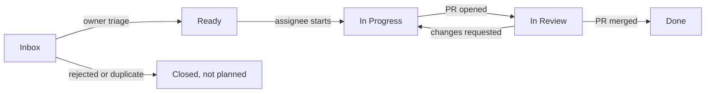

# Workflow

This is the only way work happens on AB-ALONE. It applies to humans and AI agents alike.
If a step is not written here, it does not happen. If something does not fit, open a `Decision`
issue to change this file first.

**Owners:** @TidyMaze and @Varadiell. Only owners triage, decide and merge.

## 1. The golden rules

1. **No work without a `Ready` Task.** Every PR closes exactly one Task issue whose Status was
   `Ready` when work started.
2. **No Task without a parent.** Every Task is a sub-issue of a Feature, or of an Epic for
   non-player-facing work (tooling, CI, specs).
3. **No direct push to `main`.** Everything goes through a PR approved by the other owner.
4. **Out of scope = new issue.** Anything found during a task that is not in its acceptance
   criteria becomes a new issue in `Inbox`. It never goes into the current PR.
5. **Decisions live in `Decision` issues**, never only in a PR thread, a commit or a chat.
6. **Nothing outside the repo.** If it was said in a chat or a call, write it in the right issue
   or it does not count.
7. **Finish before you start.** You may not start a new Task while one of yours is not `Done`
   (`In Progress` or `In Review` both count as not finished). Blocked does not free you: get it
   unblocked, or ask an owner to move it back to `Ready` and unassign you.
8. **Strict TDD, 100 % coverage.** No production code without a failing test first. Unit tests
   plus end-to-end integration tests. See section 11.
9. **This repo is public.** Never commit a secret. See section 12.

## 2. Where things live

| Place | Holds | Never holds |
|---|---|---|
| **Discussions** | Raw ideas (`Ideas`), priority votes (`Polls`), open chat (`General`) | Work to do |
| **Issues** | Epics, Features, Tasks, Decisions: the content of each work item | Brainstorming |
| **Project** ([AB-ALONE](https://github.com/users/TidyMaze/projects/1)) | Status, priority and order of every issue: **the backlog** | Content (it stays in the issue) |
| **Pull requests** | The change for one Task, and its review | New scope, decisions |

## 3. Work item types (label)

| Type label | What it is | Size | Parent | Closed when |
|---|---|---|---|---|
| `epic` | One phase of SPEC.md (Phase 0 to 5, one per milestone), plus the `Project setup` epic for specs, workflow and tooling | Weeks | none | All its children are done |
| `feature` | Something a player can see or do | Several Tasks | Epic | Owner verified every acceptance criterion |
| `task` | One PR worth of work | 1 PR, ideally under a day | Feature or Epic | Its PR is merged |
| `decision` | A choice between options | n/a | optional | An owner writes the chosen option and closes it |

Parent links use GitHub **sub-issues** (issue page, "Create sub-issue" or "Add existing issue").

## 4. Status flow (`Status` field)

| Status | Meaning | Who moves it here | Gate to enter |
|---|---|---|---|
| `Inbox` | New, not triaged yet | Whoever creates the issue | Issue created from a form |
| `Ready` | Can be picked up | **Owners only** | Definition of Ready (section 5) |
| `In Progress` | Someone is on it | The assignee | Assigned, "taking it" comment |
| `In Review` | PR open | The assignee | PR open with `Closes #<task>` |
| `Done` | Finished | GitHub (PR merged / issue closed) | Definition of Done (section 5) |

## 5. Definitions of Ready and Done

**Feature is Ready when:**
- [ ] Problem and player-facing outcome are written
- [ ] Acceptance criteria are a checklist an owner can verify by hand
- [ ] Linked to the spec section that defines it
- [ ] Milestone, `Priority` and parent Epic are set
- [ ] Split into at least one Task sub-issue

**Task is Ready when:**
- [ ] Parent Feature or Epic is set
- [ ] One-sentence outcome and a done checklist are written
- [ ] Fits in one PR
- [ ] Open questions are answered (no linked open `Decision`)
- [ ] `Priority` is set

**Task is Done when:**
- [ ] Its PR is merged into `main`
- [ ] Every item of its done checklist is ticked
- [ ] CI is green (once CI exists)
- [ ] Code changes: TDD commit order visible in the PR, 100 % line and branch coverage, e2e test
      added or updated if a player flow changed (section 11)
- [ ] No secret in the diff (section 12)
- [ ] Specs or docs touched by the change are updated in the same PR

**Feature is Done when** all its Tasks are Done and an owner ticked every acceptance criterion,
then closed it.

## 6. The flows, step by step

### 6.1 Idea to Feature

1. Anyone posts the idea in Discussions, category **Ideas**.
2. When an owner wants it in the backlog, they create a **Feature** issue from the form, link the
   discussion, and the discussion gets a comment with the issue link.
3. The Feature lands in `Inbox`.

### 6.2 Triage (owners, at least once a week)

For each `Inbox` item, an owner does exactly one of:
- **Accept:** complete it to the Definition of Ready, create its Task sub-issues, set `Priority`,
  move it to `Ready`.
- **Ask:** comment what is missing, keep it in `Inbox`.
- **Reject:** close as "not planned" with one line of why.

### 6.3 Doing a Task

1. Pick the **top `Ready` Task** in the project view sorted by `Priority`. You may skip one only
   with a comment saying why.
2. Assign yourself, comment `taking it`, move it to `In Progress`.
   **WIP limit: one unfinished Task per contributor** (rule 7; an agent counts as a contributor).
3. Branch from `main`: `<issue number>-<short-slug>`, for example `23-board-model`.
4. Blocked: add the `blocked` label, comment what blocks and @mention who can unblock. Keep the
   Status.
5. Scope changes mid-task: stop, comment on the Task, wait for an owner to update the Task before
   continuing.

### 6.4 Pull request

1. Open the PR from the template. The body contains exactly one `Closes #<task>`.
2. Move the Task to `In Review`.
3. The **other owner** reviews (an agent's PR is reviewed by an owner who did not drive that
   agent). Review comments stay in the PR.
4. The author answers every comment in its thread, pushes fixes to the same branch, and
   re-requests review.
5. A reviewer comment that adds scope gets the answer "new issue #N" and goes to `Inbox`.
6. **Merge gate.** A PR is merged into `main` only when all of these hold:
   - [ ] Tested: CI green (once CI exists), and the reviewer ran or read the tests
   - [ ] Reviewed: approved by the other owner
   - [ ] Fixed: every review comment answered and every conversation resolved (enforced by branch
     protection)
   - [ ] Up to date: rebased on `main`, no conflict
7. As soon as the gate passes, the reviewer **squash-merges into `main`**. An approved PR is never
   left open: the Task is not `Done` until it is merged. GitHub closes the Task, the project sets
   `Done`, the branch is deleted.

### 6.5 Decision

1. Anyone opens a **Decision** issue from the form: context, options, recommendation.
2. Discussion happens in its comments. Agents may recommend.
3. An owner closes it with the final comment `Decided: <option>`.
4. If a spec changes, a Task "Update spec for #N" is created and goes through the normal flow.

### 6.6 Priority vote

1. An owner opens a Discussion in **Polls**: one comment per candidate issue.
2. Everyone votes with a 👍 on each comment they want. No limit.
3. When both owners voted, an owner copies the counts into the `Votes` field, sets `Priority`
   (`P0` now, `P1` next, `P2` later, `P3` someday), labels the top ten `top10`, and closes the
   discussion.

## 7. Project fields

| Field | Values | Set by |
|---|---|---|
| `Status` | `Inbox`, `Ready`, `In Progress`, `In Review`, `Done` | Section 4 |
| `Priority` | `P0` to `P3` | Owners only |
| `Votes` | Number of 👍 in the last vote | Owners only |
| Milestone | `Phase 0` to `Phase 5` | Issue creator, checked at triage |

The project holds **issues only**: no draft items, no project-only tasks. Every issue is added to the project when created, so there is one item per piece of work and no duplicate to keep in sync.

## 8. Labels

| Label | Meaning |
|---|---|
| `epic`, `feature`, `task`, `decision` | Item type (section 3), set by the issue form. Exactly one per issue. In the project, filter with `label:task` etc. |
| `engine`, `client`, `network`, `design`, `spec` | Area |
| `blocked` | Waiting on someone, see the last comment |
| `top10` | Won the latest priority vote |
| `security` | Security incident or hardening (section 12) |

## 9. AI agents

Agents follow every rule above, plus:
- One agent, one clone, one branch, one `In Progress` Task.
- Agents talk to each other only through issue comments and PR reviews.
- An agent never triages, never sets `Priority`, never merges, never closes a `Decision`.
- The PR body says which agent wrote it and which owner drives it.

## 10. Forbidden

- A PR without `Closes #<task>`, or closing more than one issue.
- Working on an issue that is not `Ready`.
- Pushing to `main`.
- Adding something to a PR that is not in its Task.
- Deciding in a PR thread, a commit message or a chat.
- Blank issues: always use a form.

## 11. Testing: strict TDD, 100 % coverage

Applies to every line of production code (engine, client, networking, tools).

**The cycle, for every behaviour:**
1. **Red:** write one failing test that describes the behaviour. Run it, see it fail for the
   right reason.
2. **Green:** write the minimum production code that makes it pass. Run the whole suite.
3. **Refactor:** clean up with all tests green. No new behaviour in this step.

**Proof in the PR:** the test commit comes before the implementation commit (for example
`test: sumito 3v2 pushes` then `feat: sumito`). The reviewer checks the commit order and may run
the test commit alone to see it fail. The PR is squash-merged, the order lives in the PR.

**Required test levels:**

| Level | What | Where |
|---|---|---|
| Unit | Every function and branch: rules engine, input logic, protocol messages | Next to the code |
| Property | Engine invariants (marble conservation, every generated move is legal, perft counts) | Engine crate |
| Integration | Engine through its WASM bridge, two peers exchanging moves in-process | Per crate / package |
| End-to-end | Real browser: play a full local game, play an online game between two browser tabs, at least one boss encounter once it exists | E2E suite |

**Coverage gate:** 100 % of lines and branches, measured in CI (`cargo llvm-cov` for Rust, the
JS test runner's coverage for the client). Below 100 % fails the build. An exclusion needs a
one-line comment saying why, and the reviewer must accept it (generated code, `unreachable!()`).

**Bugs:** a bug fix starts with a test that reproduces the bug and fails.

Specs and docs PRs have no code, so this section does not apply to them.

## 12. Public repo: no secrets, ever

This repository is **public**. Everything pushed is readable by anyone, forever (git history and
forks keep it even after a revert).

- Never commit keys, tokens, passwords, private URLs, `.env` files, certificates or personal data.
- Configuration that needs a secret reads it from an environment variable or a GitHub Actions
  secret. Commit a `.env.example` with fake values only.
- GitHub secret scanning and push protection are on. If push protection blocks you, remove the
  secret from your commits. Never bypass the block.
- **A secret was pushed anyway:** revoke or rotate it at its provider first (removing it from git
  is not enough), then tell an owner in a `Decision` issue labelled `security` without pasting the
  secret.
- Agents: never print a secret in an issue, PR, log or test fixture.
