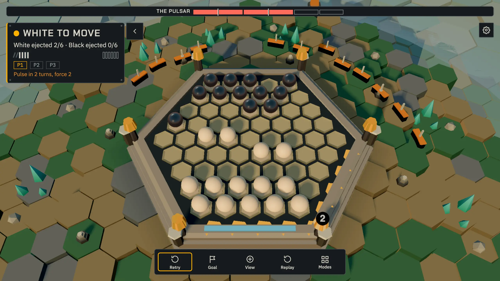
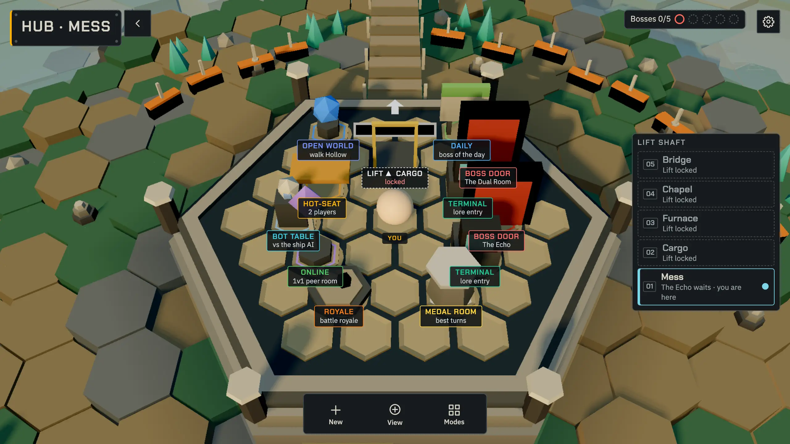
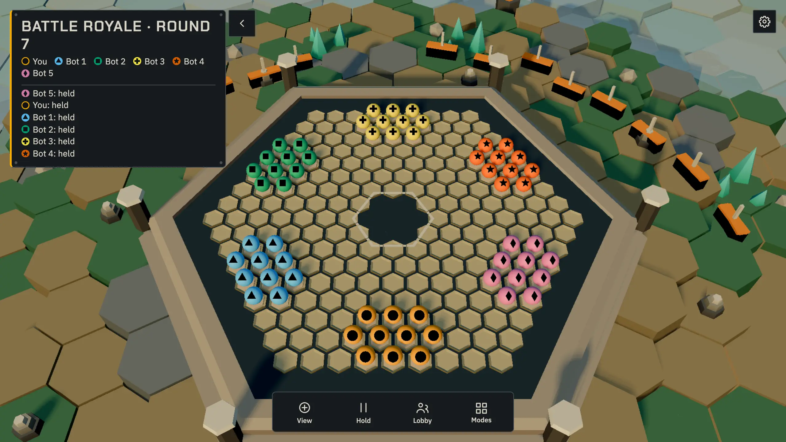
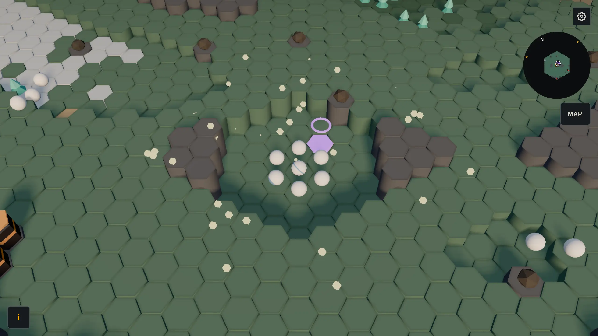
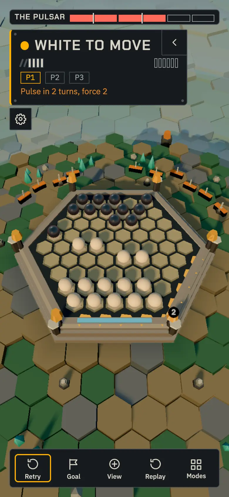

<div align="center">

# Edgefall

**You are alone. They are shelled. Push them into the void.**

[](https://github.com/TidyMaze/ab-alone/actions/workflows/ci.yml)
[](https://tidymaze.github.io/ab-alone/)

### [▶ Play in your browser](https://tidymaze.github.io/ab-alone/)



No install, no account, no server. Just a board, the dark, and whatever is left of the crew.

</div>

---

## The signal

The **CSV Ballast**, a 2.1 km ore hauler, drifts over **Hollow**, a dead moon. Power at 11 %.

The crew mined slag-glass. Slag-glass remembers heat. Everyone who touched it hardened from the
skin inward, rounded off, and kept moving: black spheres with a faint pulse.

Before the end, the captain ordered every dispute settled on a board, so nobody else would get
hurt. The ship mind, **TALLY**, still enforces it. Pushing a marble off the board is the old
airlock cycle in miniature. Whoever goes over the edge is gone for good.

You are the last one with a clear visor. Six of them over the edge, and you walk out.

## The game

Classic push-marble rules underneath: 61 cells, 14 marbles each, push 1 to 3 in a line, out-number to shove.
First to eject 6 wins. On top of it, the ship:

- **Play alone or together**: hot-seat on one screen, versus TALLY's bot (alpha-beta, in a Web Worker, with its estimated rating and level on the HUD, a boss's too from its own search, growing with the bosses beaten and along a rogue-lite run),
  online 1v1 peer to peer with an invite link, ranked online (Elo), a gamepad.
- **15 souls-like bosses**, each bends one rule, tells you one move ahead and has an answer on the
  board: The Echo, The Hull, The Choir, The Chaplain, The Ballast Mind, The Alien, The Rail Yard,
  The Magnetizer, The Pulsar, The Overseer, The Assembly Line, The Unstable Core, The Dual Room,
  The Stalker and The Swarm. A medal per beaten boss, with your fewest turns, and a victory and a defeat line of Tally's of its own for each. The story ends when the ladder reaches its top: a short skippable epilogue, once, and the docking clamp reads open on the bridge and in the Open world. Die, read the tell,
  retry with the same seed. Rules per boss: [docs/specs/boss-balance.md](docs/specs/boss-balance.md).
- **Daily challenge**: one boss and one seed for everyone each UTC day.
- **Rogue-lite run**: 3 acts (4 with the three keys) of an illustrated branching map (an icon per kind of node, a legend, the path taken and the nodes to pick marked) of fights, your army carried from fight to fight,
  every marble lost is lost for the run, relics, passive effects for the whole run, from elites,
  act bosses and treasure nodes, and rest sites where you rest or upgrade a special marble (Heavy+,
  Anchor+, Spark+), up to 3 one-use tactics to play in a fight (Reinforce, Freeze, Swap, Fall back),
  scrap earned in fights and spent at shop nodes on marbles, special marbles, relics, tactics and flask charges, 2 flasks an act (refilled at each act) that heal 3 marbles on the map between nodes, and
  seven special marbles in all (Heavy, Anchor, Spark, Magnet, Shield, Bomb, Medic), explained on the fight's HUD (a legend line for each one on the board you have not met, a card with its rule when you hover it or tap its line) beside your army, the army your run ends below and the marbles lost in red, enemy armies
  that vary (five formations, special marbles of their own, more in later acts, and the named elites The
  Wall, The Artificer and The Brute), twenty-one events with two or three choices, some of them gambles, one of them a cursed chest (a relic or three Heavies, but the marbles lost in the next 2 fights cost 2 each), a move budget in each act, whose fights won within it open a bonus room (a relic and scrap) before the boss, "?" nodes
  that turn into an event, a fight or a treasure when entered, two exits at the end of each act to biomes (Forest, Tundra, Desert,
  Badlands, Archipelago) with holes in their boards, a signature enemy and a boss of their own, and cells and blueprints dropped by elites and act bosses,
  banked at the Collector between acts to unlock relics, tactics and special marbles for good, a scroll of power at the end of each act that grows one of three affinities (Force, Tactics, Chaos) and adds a rule to its special marbles, and four commanders to start a run with
  (The Captain, The Warden, The Saboteur, The Juggernaut), each with a starting relic and a style of its own, unlocked by acts won, a build (special marbles, relics, Reinforce and Fall back) that comes into the fights of the twelve act bosses that play Abalone on their own board, all but The Echo, The Choir and The Swarm, and the map says before the fight whether a boss takes it, four double-edged boss relics (one of the three offered by an act boss), three runes found for good by beating each named elite once, that open a secret room, a shortcut and a secret exit on the maps of later runs, three keys taken by costly choices (the first elite of an act, a rest given up, a treasure given up) that open a fourth act, an elite then The Ballast Mind, and ten ascension levels, each unlocked by winning a run at the one before and adding a handicap to the next run ([spec](docs/specs/roguelite.md)); a start screen that says what a run is with one Start button, the commanders, ascension levels, runes, blueprints and the daily run behind More, a score at the end of a run, a Daily run (the seed of the day for everyone, one try a day, its score kept), the history of your last runs and a compendium of the relics, special marbles, tactics and events you have seen, the rest as silhouettes; Auto-play can play a fight, and an AI agent can play a whole run through the MCP server (below).
- **Trainer**: waves against the bot, one more marble each wave.
- **Stalker mode**: a fog of war against the bot.
- **Boss with a partner**: two players share one army against a boss, online. **Boss vs a player** puts a second player in the boss seat; **Solo boss fight** is against the bot. A lobby nobody joins offers a bot game of the same kind after 20 s while the room stays open, and a line to switch to the room when a player joins (a bot game is never rated).
- **Battle royale** on the Furnace deck: up to 6 seats, hidden orders, bots fill empty seats.
- **Hub**: walk five decks, a door per boss, a room per mode, lore terminals. Every boss you beat shows its own short lore entry under the victory banner once the story has reached it (the story opens in order, and a sealed line holds a later entry back), and the log archive (Logs in the cog menu) keeps the entries and the logs of the Open world you read. A new player first gets a three-line cold open and a short scripted fight that ends on the first ejection, then lands there, where one line always says the next goal (The Echo first, then a first rogue-lite run, then the boss of the next deck) and the room it points to is the one loud station, the others quiet (the first run plays once, and can be skipped). A notice board card of the Hub says today's daily and how it went, the next boss, the medals still missing and a daily streak kept on your device. The Echo's goal is a card of two steps and a picture. Every boss is a station of one deck of the wrecked Ballast, with its own Tally line, a one-line blurb (the tooltip of its button in the boss lists) and a goal in its own voice; each town of the Open world files a ledger line of Tally on the Hub when entered, once the story has reached it. The illustrated guide to the rules and the controls of their device no longer opens by itself: Guide in the cog menu opens it.
- **Open world**: a generated hex map of six biomes, one per sixth of the hexagon (meadow, forest, tundra, desert,
  badlands and an archipelago), a hero marble you walk and a troop that fights on its own, both sailing
  across the water on small boats, with a minimap in the top right corner, a map of the world discovered round the hero (M, or the Map button) and
  teleporters to travel between the ones discovered (T, or the Teleport button, on a teleporter), a sky that goes through day, dusk and night
  in 12 minutes, a lair fight on a board dressed for the hour you entered it at, and wandering marbles that walk up to your hero and start a wild
  fight against the bot you can flee with the Flee button or F, and twelve lore logs on stakes, each read by rolling onto it and kept in the world's save, and towns and dungeon gates placed by the seed that show on the map beside the towers (the nearest tower holds the easiest boss and the towers go up in difficulty outward in rings of three, the map and the Nearest tower button leading you ring by ring, and a gate's dungeon tier is its ring): roll onto a town to enter the Hub and onto a dungeon gate to start a rogue-lite run, and the Back to the Open world button returns you to the cell you came from. Every marble the troop pushes into the water or off the edge of the world joins it as a recruit, up to five, and a tower you beat by walking onto it in the world leaves a teleporter pad beside it, so you can come back ([spec](docs/specs/openworld.md)).
- **An AI agent plays** over MCP ([below](#let-an-ai-agent-play)).

Rusted deck plates, cold light, fog at the rim. The camera orbits and zooms; a **Clear board**
setting (cog menu) drops the fog.

<p align="center">
  
  
  
  
</p>

## Under the hull

```
crates/edgefall-core   Rust rules engine: moves, sumito, draws, bot search, boss encounters, battle royale
crates/edgefall-wasm   the same engine compiled to WebAssembly for the browser
crates/edgefall-cli    play in a terminal (debug tool)
client/               TypeScript + Three.js (WebGPU, WebGL2 fallback), Vite
mcp/                  MCP server: an AI agent plays the bot or a boss over stdio
```

- **One engine, every peer.** Both browsers run the same WASM rules and replay each other's
  moves, so an illegal or tampered move never lands.
- **Online without a server.** WebRTC through Trystero, signaling over public Nostr relays.
  Moves are Ed25519-signed and hash-chained. Each seat is bound to one key; extra visitors watch.
- **Hosted on GitHub Pages.** Free, static, deployed on every merge to `main` that changes the game (docs, tests and CI merges don't deploy; Actions > Pages > Run workflow deploys by hand).
- **Tested hard.** Strict TDD, 100 % unit coverage of all the code (engine, client, MCP server),
  Playwright end to end in Chromium, the full suite run locally before every merge.

## Run it locally

```bash
cd client && bun install && bun run dev
```

Needs [bun](https://bun.sh), Rust and `wasm-pack`: `bun run dev` builds the WASM engine first.
Full gate before a push:

```bash
scripts/verify.sh
```

Homebrew Rust without rustup needs a couple of environment variables, see
[CONTRIBUTING.md](CONTRIBUTING.md) section 13.

## Let an AI agent play

`mcp/` is an [MCP](https://modelcontextprotocol.io) server: an AI agent plays a game against the
bot or a boss through tools, and the engine judges every move. It runs on your machine over stdio, nothing is
hosted. Build it once, and again after pulling `main`:

```bash
(cd client && bun install) && cd mcp && bun install && bun run wasm
```

Then add it to your MCP client, with the absolute path of your checkout. Claude Code:

```bash
claude mcp add ab-alone -- bun /path/to/ab-alone/mcp/src/main.ts
```

Other clients (Claude Desktop, Cursor, ...) take the same command in their JSON config. If the
client does not find `bun`, give its full path (`which bun`).

```json
{
  "mcpServers": {
    "ab-alone": { "command": "bun", "args": ["/path/to/ab-alone/mcp/src/main.ts"] }
  }
}
```

The agent is Black and moves first: `new_game`, then `legal_moves` and `play_move` (the bot
replies in the same call) until the game is over, or `resign`. `get_state` shows the board. Moves
use the notation of `edgefall-cli`, for example `(1,3)>NE`. Tools, fields and error codes:
[docs/specs/mcp.md](docs/specs/mcp.md). `new_game` with `boss` (one of the ids in its input schema) and
an optional `seed` starts a boss fight: `get_state` then shows the boss phase, tell and marks.

An agent can also walk the Open world (`new_world`, `world_step`, `world_walk`) and play a whole rogue-lite run
(`new_run`, `run_state`, `run_pick`, `run_place`, `run_choose`, `run_tactic`, `run_flask`, `save_run`): the map, rewards, relics, events,
rests, shops, the Collector and the exits are the client's own code, and a fight is played with `get_state`, `legal_moves`
and `play_move`. The same seed and choices give the browser's run.

Online, the agent plays a human or another agent over the same P2P rooms as the browser:
`create_room` gives an invite link a human opens, `join_room` takes a link or a room code. Then
`wait_for_opponent_move` and `play_move` in turn. The server imports the client's online code, so
run `bun install` in `client/` too.

How the game and the network work: [docs/architecture.md](docs/architecture.md).

## Contribute

- Built by two co-developers: [@TidyMaze](https://github.com/TidyMaze) and
  [@Varadiell](https://github.com/Varadiell)
- What we build: [SPEC.md](SPEC.md) and [docs/specs/](docs/specs/)
- How we work, strictly, issues first: [CONTRIBUTING.md](CONTRIBUTING.md)
  (AI agents: [AGENTS.md](AGENTS.md))
- Backlog: [project board](https://github.com/users/TidyMaze/projects/1)
- Ideas and votes: [Discussions](https://github.com/TidyMaze/ab-alone/discussions)

> This repo is public. Never commit a secret.

<sub>Edgefall was called ab-alone until 2026-11-08 (#1616). Earlier lives of this board: [Abalone](https://github.com/TidyMaze/Abalone) (Java),
[abalone-go](https://github.com/TidyMaze/abalone-go) (Go).</sub>

## Name

- The official short form is "Edgefall", never "Edge" (#1616). Public names with the "edging" puns are
  refused: `client/src/namefilter.ts`.
- The name is never translated, in any language. French players say it "edj-fol".
