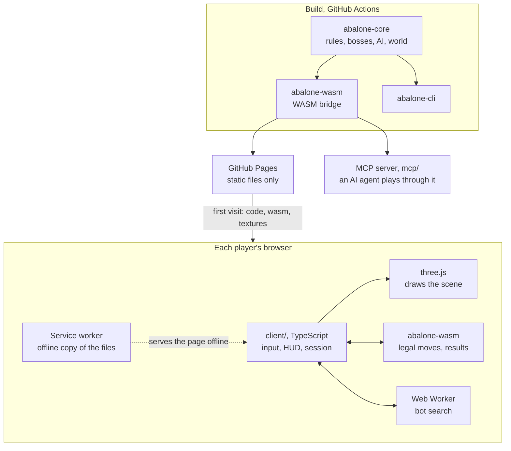
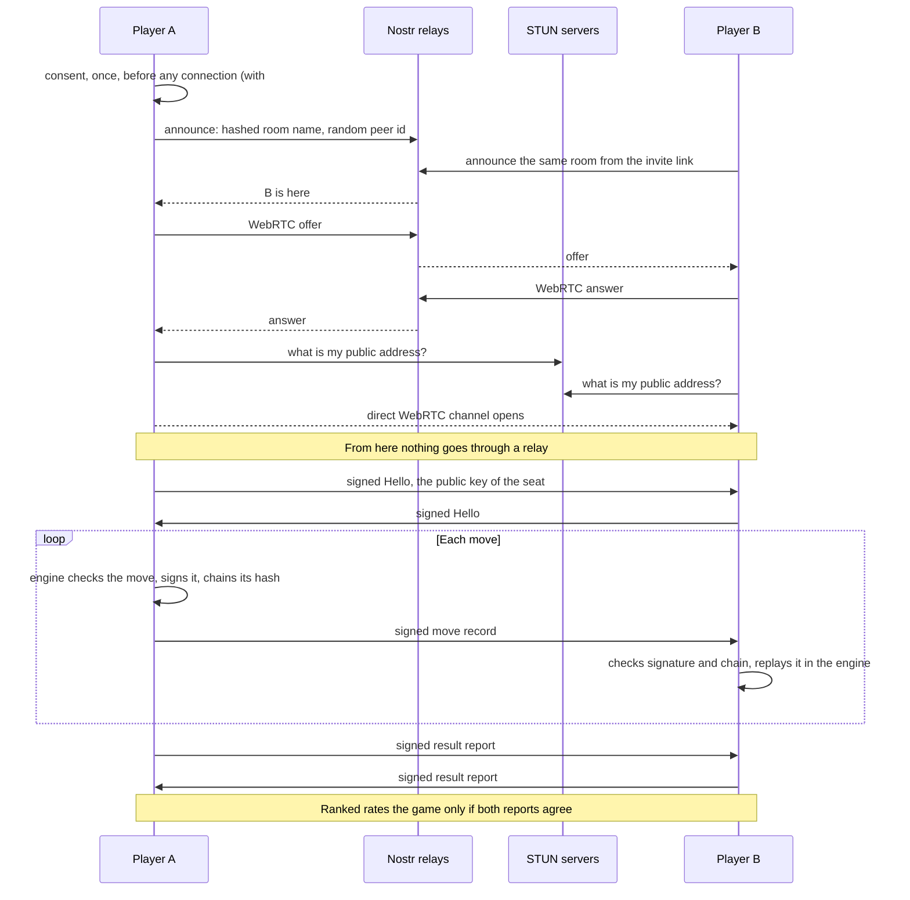
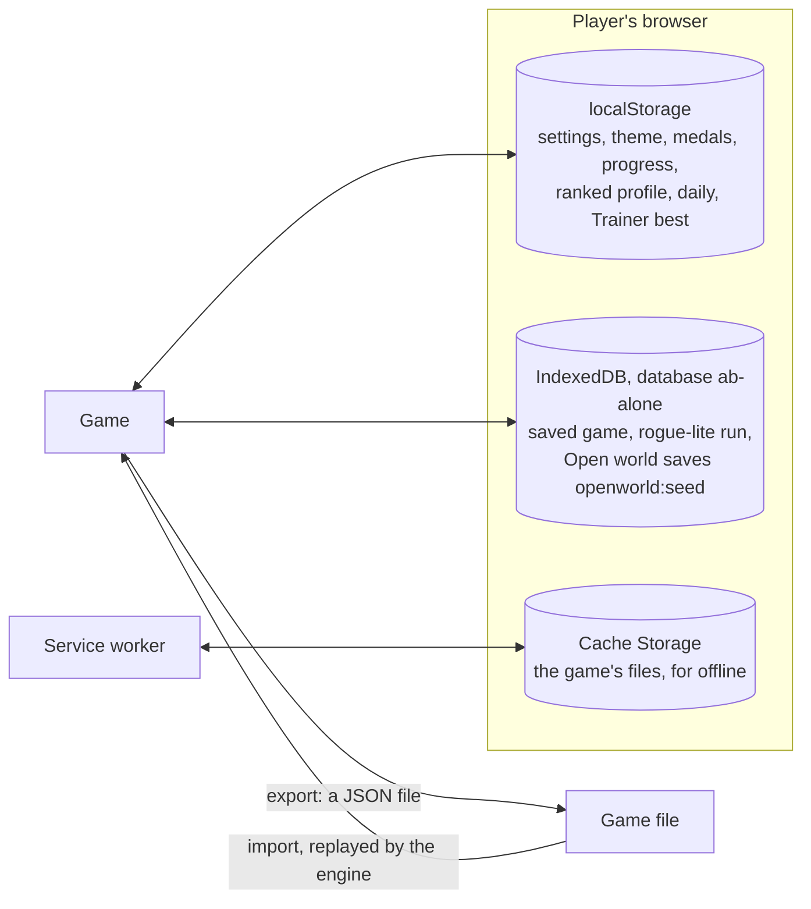

# How ab-alone works

The game has no server of its own. A static site brings the code, every browser runs the same Rust rules, and players talk to each other directly. The details are in [`docs/specs/tech.md`](specs/tech.md) (sections 2, 6, 8, 9) and [`docs/specs/multiplayer.md`](specs/multiplayer.md).

## 1. What runs where

One Rust core is compiled for every place that needs the rules: the browser, the CLI and the MCP server. The client only draws, reads input and animates.

The rules are deterministic: the same moves give the same position on every machine. That is what the rest of this page relies on.

## 2. An online game

Relays only introduce the two players. Moves then go straight from browser to browser.

Nobody arbitrates: each browser is a judge. A move that fails the signature, the hash chain or the rules is refused by the honest peer.

A peer that loses its connection asks for what it missed with `sync`, and the other answers with `missed`, signed records it can check again.

Battle royale has more players, so moves are hidden until everyone has chosen: each player sends a signed commit, then a signed reveal, and a coordinator only opens the rounds.

## 3. Where data lives

Everything stays in the player's browser. Nothing is stored on our side, because we have no server.

| Data | Stored as | Rule |
|---|---|---|
| Local game | The list of moves, not the board | Replayed by the engine on load; a save that does not replay is deleted |
| Open world | Seed plus changes: hero, troop, enemies beaten, broken cells, lairs | The terrain is computed from the seed, so it is never stored |
| Online game | Not saved | The signed log lives for the session |
| Ranked rating | A profile in localStorage | Editable by its owner, so nobody else can trust it |

Clearing site data loses everything. There are no accounts and no sync between devices: the export file is the way to move a game.

## 4. What crosses the network

| Channel | What | Who sees it |
|---|---|---|
| GitHub Pages | The files of the game | GitHub |
| Nostr relays | Announces: hashed room name, random peer id, nonce. WebRTC offers and answers | The relay operators |
| STUN | A request for the public address | Google, Cloudflare |
| WebRTC, direct | Hello, moves, reports, sync, royale rounds, co-op; in the public Open world a Hello and the hero's cell (7 bytes, at most 4 a second) | The players in the room, who also see your IP address |

No move, name or position goes through a relay. Announces are ephemeral Nostr events, which relays are not expected to store. See [`docs/privacy.md`](privacy.md).

Measured on 2026-11-01, one tab alone in a room for 25 s: 5 relays, 25 announces, 12 KB sent in all.

## 5. What is trusted

| Protected | How | Not protected |
|---|---|---|
| A move is legal | Replayed by the opponent's engine | |
| A move is from that seat | Ed25519 signature, one key per seat | |
| The log was not changed | Each record chains the hash of the last | |
| A ranked result | Both sides sign a report that must agree | Playing against yourself in two tabs, and rating edited locally |
| Solo, bosses, Open world | Nothing: the client is trusted | A modified client can win anything alone |

Without a server there is no way to stop a player from colluding with themselves. See the audit on [#1319](https://github.com/TidyMaze/ab-alone/issues/1319).

## 6. Planned

The shared Open world ([#1305](https://github.com/TidyMaze/ab-alone/issues/1305)) and the ranked leaderboard ([#1287](https://github.com/TidyMaze/ab-alone/issues/1287)) add shared state without a server. Live positions go directly over WebRTC in small rooms, and lasting changes are signed events, replayed by the Rust rules, that exist while one player still holds them. Of the Open world, only the first slice is built: on the public world (seed 1305, after the opt-in) one room `ow:1305:0` shows the other heroes' markers and edge arrows, unsigned and cosmetic (`client/src/worldpeers.ts`). Shards, a beacon and shared changes are not built; the ranked leaderboard is not.
