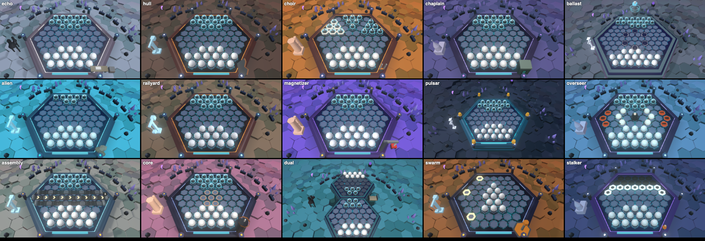

# Art direction

Status: v0, for issue #283. The art and sound direction of [world.md](world.md) and [ui.md](ui.md)
on one page, for whoever makes an asset, then the asset list and its budget (#61). It adds no lore
and no new look: each rule names its source (section numbers), and changes when its source does.

## 1. Direction

Status: v1 (#1550, 2026-11-07), the neon look of #1424 as the game ships it. The look's default is the owner's
decision (#1424); until it flips, the neon look is on at `?look=neon`. Numbers are read from `client/src`.

- **Brief.** A viewport onto a dark circuit slab lit by cold light: slate cells in near-black gaps, neon on the
  edges, lines and lamps, the player's cyan as the one light that moves. Never a web app around a canvas; clarity of
  play wins over mood (ui.md 1). The player is the last warm thing aboard, an opaque white marble; the crew hardened
  into black shells and still plays by the rules (world.md 2).
- **Tone.** Cosmic dread, grief, bureaucracy. Never gore for its own sake (world.md 2).
- **Palette (neon, #1550).** Every colour is one of these tokens. The hue check (`client/src/artpalette.test.ts`)
  fails on any colour of `NEON` (`neonlook.ts`) or of the first `:root` of `ui.css` that is not listed here.
  Sky `#04050c`, gap `#0a0e18`, gap floor `#020307`, slab `#171c2b`, rim `#0f1320`, rim light `#39466a`,
  ground `#1d2433`, far ground `#131824`, cell `#5d6a82`, boulder `#2c2f36`, black marble `#14161a`,
  white marble `#f2f0ea`, neon cyan `#19e6ff`, turn cyan `#5fd0e6`, pedestal ring `#7fd6e8`, violet `#9a6bff`,
  crystal `#6a609f`. Chrome (`ui.css`): base `#0b0d0f`, panel `#161a1d`, edge `#4a5258`, text `#d8d4c8`,
  muted `#9aa3a8`, accent `#7fd6e8`, hazard `#d9822b`, danger `#ff6b5a`. Light: sun `#e8f0ff`, sky
  `#9a6bff`, sky mix `#e8eeff`, ground `#2a3347`.
  The hues are cyan and violet on near-black. Sodium `#d9822b` is hazard, and the Furnace's key; red `#ff6b5a` is danger only.
  The slab takes 12 % of its deck's key over `slab` (#1551).
  Nothing saturated outside this list. Colorblind palettes (protan, deutan, tritan, high contrast) are chosen in the
  settings menu (#381). Dark is the deck; light is only a fallback.
- **Materials.** Slate and steel, flat tones painted on the geometry (`neonPaint`), a neon edge line on each cell.
  Nothing emissive but the edges, the lamps, the screens and the marbles.
- **Marbles** (world.md 5, 8). Player: an opaque white sphere (`#f2f0ea`), no core, one of the white skins of the
  settings. Shell: black (`#14161a`), a faint heat pulse, no core. The pulse is a slow sodium glow, one every 6 s,
  far fainter than a flash; off under safe mode, reduced motion and the
  low tier (#509). Boss: the shell plus one accent, a rust crown for The Hull, candle wax for The Chaplain, a wire
  wrap for The Ballast Mind (#507); The Echo and The Choir keep the plain shell, the Choir's army glyphs are its shape
  cue. Both sides read as glossy spheres under both looks (#1553): a sharp sun highlight and a fresnel rim (the shell's cyan, a soft pale
  edge on the white), the white shaded by its normal so its lit cap stays under 255 and does not bloom, and a reflection of the sky on
  each, a colour node of the reflection vector (`marbleSheen`, `NEON_SHEEN` in `neonlook.ts`: strong on the black shell, a hint on the
  white). It needs no envMap, no texture and no draw call, so the black shell is a sphere, never a hole in the board, on the low tier
  and under automation too, where the PMREM reflection is left out; on the high tier it adds to the envMap. Side is told by value first
  (black shell against light white), the colour-blind palettes change no marble colour. Flipped by The Chaplain: ridges creep up the glass. Silhouette before colour. Each marble starts turned its
  own way and each cell disc is turned by its own angle, seeded, so the set never lines up and a game always looks
  the same.
- **Light** (world.md 5). One cold sun low on the left (`#e8f0ff`, 3.2), a violet-tinted hemisphere (sky `#9a6bff`,
  ground `#2a3347`, 2.9), ACES at 1.15. The player's cyan is the light that moves. Tube lights, a ring lamp and the
  sky glow (`neonlight.ts`, `neonfx.ts`) are the only other sources. Fine stars on a black sky, no haze. Soft
  contact shadows ground marbles onto the cells (#459), off under the low tier and automation. Visuals are judged by the art director on captures, no contrast test (owner, 2026-11-07).
- **Decks** (world.md 1, 3, 5). Mess: warm lamp, worn laminate (hot-seat, The Echo). Cargo: cold slate and ore dust
  (online, The Hull). Furnace: sodium glow, steam (The Choir). Chapel: candles, wood and wire (The Chaplain). Bridge:
  cold white, too clean (The Ballast Mind). Under the neon look each deck has its key (`DECK_KEY`, `neonlook.ts`, #1551):
  the rim glow takes it (warm `#d8d4c8`, cold `#7fd6e8`, sodium `#d9822b`, candle `#6a609f`, white `#e8f0ff`), the posts
  glow in its accent, the slab takes 12 % of it. The cells and the marbles keep their colours on every deck. **Boss spaces** (#1551): a boss fight is never the plain Mess table. One table keyed by boss id (`BOSS_SPACE`, `bossspace.ts`) gives each of the 15 bosses its own sun (colour, height, direction, strength between 0.6 and 1.25 of the arena's, never behind the board), its rim and post glow, how far the ground outside the board (0 to 0.6) and the sky (0 to 0.5) lean to its key, and its scatter round the board (the particles of the deck, replaced). Any two bosses differ in at least three of those, and each differs from the Mess in three (`bossspace.test.ts`). The terrace look takes the sun, the hemisphere and the sky only, a lair's board look of the Open world over it. **Act spaces** (#1551): a fight of a rogue-lite run is drawn in the space of its act's biome, from a second table of the same shape (`ACT_SPACE`, `bossspace.ts`, keyed by the biome id of roguelite.md section 18): the Meadow a clear morning over a pale green ground with pollen, the Forest a dim cold light from above over a deep teal with spores, the Tundra a low white light over snow with drifting flakes, the Desert a hard sodium light over sand, the Badlands a dull light over red rock with grit, the Archipelago a bright light off the water over a deep blue with mist. The green is the cold cyan and sodium tokens mixed. Plain fights, elites and the fights of a run saved before the exits (the Meadow) take it; the act's boss keeps its own boss space. The run's violet rim and posts stay on top (`RUN_KEY`), on its map too, and say where the run is (#1554, `runKey`): the violet leans a quarter more to the danger red each act (act 3 `#d46bc4`, three quarters from act 4 on) on the rim, the slab edge and the posts, and an elite fight is all hazard sodium, rim and posts; the ground and the sky outside the board lean to the act's surround. Any two acts differ in three of the same ways as two bosses and each from the plain Mess (`bossspace.test.ts`). No new draw call or texture (the scatter reuses the deck's one Points mesh). The page marks it with `body[data-space]` (the biome id, or the boss id). **Entrance beat** (#1551, motion.md story 9): the same row says how the boss arrives. `beat` is the camera move (`orbit` round the board, `drop` from high above, `rise` from low, `pull` out from close), `side` the side of the board the camera starts on (45 to 90 degrees, on the side of the light for a boss lit from a side), `dark` the share of the light the fight starts with (0 to 0.3). No two bosses share a move and a side, and all four moves are used (`bossspace.test.ts`). A card names the boss and its deck. No model, no draw call, no texture: the camera, the sun and hemisphere strength and one DOM card. **Deck props** (#1551, `deckprop.ts`): each deck stands one silhouette prop in the surround outside its board, drawn on the arena's terrace in both looks and not in the room or at the hub: the Mess's vent hoods over the galley, the Cargo hold's crane with a crate on its cable, the Furnace's chimney stacks, the Chapel's spire and cross, the Bridge's navigation mast with its yards and radar plate. Procedural boxes and six-sided prisms (72 to 108 triangles), merged into one mesh and one draw call, one lit material, no texture, no shadow; 2 to 2.4 cells tall, the colour of the deck's key lightened by 35 % of the white marble's token (palette tokens, 3:1 on the black sky and on the terrace background). Its spot is outside the posts and beacons: the left of a desktop window, level with the lower half of the board under the goal panel, and below the board on a phone above the dock (`deckPropSpot`, both clear of the goal panel and the buttons, and not the south-east where a boss's kit piece stands), and it goes out with the board's radius. `deckprop.test.ts` checks that every box of a prop stays in the window at 960x540 and 390x844 and that no ray from the play camera to a cell or a marble of the outer two rings meets one, from any azimuth down to a pitch of 38 degrees and through the entrance beat of every boss. The low tier draws it (one call, about 100 triangles, nothing to load). A boss's own kit piece (`bossprops.ts`) stands off the south-east beside it. Palette tokens only. **The Mess and the Cargo hold on the terrace look** (#1551): the plain Mess table and the Cargo hold with no boss have their own surround there too, the way the neon look leans the ground and the sky to a deck's key (`terraceDeckLook`, `boardlook.ts`): the colour beyond the board leans 0.45 and the tint of the lit board 0.24 to the deck's key, the Mess's warm lamp with a little sodium, the Cargo hold's cold slate (the Mess one warm, the Cargo one blue, `boardlook.test.ts`). The other decks' fights are boss fights, which have their space. **The Mess prop** is the black marble's token, dark, not the pale mix of the others: a pale prop read 2.7:1 on the pale ground of the neon look and 3.1:1 on the terrace's, the dark one reads 4.3:1 and 3.4:1 (measured on the render at 960x540, `deckprop.test.ts`). Left: a haze (the terrace and the neon look draw no fog: the sky and ground tint stand in, and a fog is a new pass or a per-pixel cost on the low tier, so none), a new model per boss. Fog thickens toward the rim, never over a cell. The Pulsar's fight is drawn
  in space (#1146): the bay is hidden, a field of stars and a distant glow take the backdrop, the board and the lamps
  stay (#1189).

  **Capture sheet** (#1551, neon look, 960x540, HUD hidden, local GPU, after the entrance beat): one capture per boss, `1551-hudoff-neon-960x540-<id>.png` on the `pr-screenshots` branch, and the sheet of the 15: . What tells each apart (surround, light, scatter, and the prop or board of its fight):

  - [echo](https://raw.githubusercontent.com/TidyMaze/ab-alone/pr-screenshots/1551-hudoff-neon-960x540-echo.png): cold white surround, light from the right, glints; the mirror room, a dark pawn silhouette.
  - [hull](https://raw.githubusercontent.com/TidyMaze/ab-alone/pr-screenshots/1551-hudoff-neon-960x540-hull.png): rust brown surround, hard low light from the left, falling ore; the crane prop.
  - [choir](https://raw.githubusercontent.com/TidyMaze/ab-alone/pr-screenshots/1551-hudoff-neon-960x540-choir.png): sodium orange surround, steam climbing; the chimney stack, the army rings.
  - [chaplain](https://raw.githubusercontent.com/TidyMaze/ab-alone/pr-screenshots/1551-hudoff-neon-960x540-chaplain.png): violet surround, light from straight above, smoke; the spire.
  - [ballast](https://raw.githubusercontent.com/TidyMaze/ab-alone/pr-screenshots/1551-hudoff-neon-960x540-ballast.png): slate grey surround, no scatter; the stepped bridge plinth and the beacon above.
  - [alien](https://raw.githubusercontent.com/TidyMaze/ab-alone/pr-screenshots/1551-hudoff-neon-960x540-alien.png): cyan surround, spores; the eggs.
  - [railyard](https://raw.githubusercontent.com/TidyMaze/ab-alone/pr-screenshots/1551-hudoff-neon-960x540-railyard.png): grey brown surround, long light from the right, steel dust drifting sideways; the rails.
  - [magnetizer](https://raw.githubusercontent.com/TidyMaze/ab-alone/pr-screenshots/1551-hudoff-neon-960x540-magnetizer.png): bright violet surround, filings drifting sideways; the cranes.
  - [pulsar](https://raw.githubusercontent.com/TidyMaze/ab-alone/pr-screenshots/1551-hudoff-neon-960x540-pulsar.png): near black navy surround, hard side light, cyan stardust; the lit beacons.
  - [overseer](https://raw.githubusercontent.com/TidyMaze/ab-alone/pr-screenshots/1551-hudoff-neon-960x540-overseer.png): sky blue surround, pale light from above; the watch rings.
  - [assembly](https://raw.githubusercontent.com/TidyMaze/ab-alone/pr-screenshots/1551-hudoff-neon-960x540-assembly.png): light grey green surround, work light from the left, weld sparks; the conveyor belt.
  - [core](https://raw.githubusercontent.com/TidyMaze/ab-alone/pr-screenshots/1551-hudoff-neon-960x540-core.png): rose surround, hot embers; the ring of cells.
  - [dual](https://raw.githubusercontent.com/TidyMaze/ab-alone/pr-screenshots/1551-hudoff-neon-960x540-dual.png): teal surround; the two boards.
  - [swarm](https://raw.githubusercontent.com/TidyMaze/ab-alone/pr-screenshots/1551-hudoff-neon-960x540-swarm.png): sodium orange surround under a dim light, a thick drift of dark flecks; the hives.
  - [stalker](https://raw.githubusercontent.com/TidyMaze/ab-alone/pr-screenshots/1551-hudoff-neon-960x540-stalker.png): indigo surround, dim lamp; the dark board and its bright cells.

  Measured on the 15 captures (mean RGB of the side strips outside the board and of the top 70 px, Euclidean distance over both): no two are closer than 30.7 (Chaplain and Ballast: violet against slate). On the surround alone the closest pair is the Echo and the Assembly (19.5, two pale greys), told apart by their light direction, scatter and board. The Swarm and the Hull were 17.0 apart before and are 52 apart now (the Swarm surround is the sodium token, the Overseer ground 0.5).

- **Open world** (#1177, #1173). Carried over from the board: the sky and fog fade to the neon black `#04050c`, wall
  edges and the cap use sodium `#d9822b`, and the ground, rock, peak, water and biome grounds are pulled toward the
  slate of the palette. The hero and its troop wear the white marble, the foes the black shell (#1176). The HUD plate
  and chip use the shared `--panel`, `--edge`, `--text`, `--plate-accent`, `--target`, `--r-card` tokens (#1172).
  The props and landmarks are flat-shaded vertex-coloured models; the low grass is tinted per biome (meadow, forest,
  tundra, desert, badlands, archipelago). Open, not yet checked by the hue test: the biome grounds and the models.
- **Type** (ui.md 3). Chakra Petch 600, uppercase, for the turn and the result; IBM Plex Sans for
  the rest. Sizes in rem, nothing under 0.8125rem.
- **HUD** (world.md 6). The board, its rim and its frame carry the game, menus are a terminal in
  the scene, the flat plate is the fallback. A legal target is a near-black ring and arrow flat on
  its cell, pointing the way the group goes, 3:1 on the deck (#390).
- **Motion** (world.md 5, 8, ui.md 6). Weight and vacuum. A moved marble rolls to its new cell in
  200 ms, without slipping. An ejected marble rolls over the rim in 200 ms, the void takes it in
  600 ms, it only fades. The chrome fades in 160 ms, nothing loops. Reduced motion: a plain fade.
  Never more than 3 flashes a second.
- **Sound** (world.md 7). Low, weight first, silence as a tool. A hum per deck; a knock per move,
  a scrape per sumito, lower for more marbles; an ejection's inhale, thud and silence, then a toll
  for lost glass or a clack for a lost shell. Drones, never a melodic loop. Every cue has a visual
  twin.
- **Voice** (world.md 2, 4, 11). Tally says one short accounting line at the start and the end of a
  match ("Mess: one remaining.") and never explains itself. No voice acting.
- **Never.** Any colour outside the palette bullet of section 1; a tell shown by a flash, a halo or colour alone (world.md 5, 8); red for a normal
  state, an effect over a cell or a legal target (ui.md 1); a flat overlay as the only copy of
  game information (world.md 6); cutscenes or lore that blocks progress (world.md 4); anything
  taken from an existing work (world.md, header).

## 2. Assets

**Budget** (tech.md 9, #61): initial load under 5 MB gzipped, a deck under 15 MB. At 0b64f5e the
first screen is about 0.6 MB gzipped (JS 258 KB, wasm 41 KB, textures 171 KB, app icons 98 KB).
Art gets 3 MB per deck at most. Models are glTF with meshopt (#701). Every texture ships as KTX2,
encoded at build time from its PNG or JPG source in `client/textures/` (#700, tech.md 9); the
sizes below are the sources'.

**Made by**, the first that works: **procedural** (run-time code: geometry, materials, Web Audio;
no file), **generated** (a seeded script in `client/scripts/` like `gen-assets.mjs`: same seed,
same bytes, tested, output committed), **hand-made** (a contributor's own work in a free tool,
source kept out of the Pages artifact). All under the repo's MIT licence; the fonts are SIL OFL
1.1. Never (#283): a download, an online generator, a paid service, a non-commercial licence.

| Assets | Format and budget | Made | Today, issues |
|---|---|---|---|
| Marbles: skins, boss accents, flipped look | Materials, geometry; 20 skins of 512 px maps (albedo, normal, roughness, and the metalness, ambient occlusion or emission map an asset ships, 67 in all), 3.6 MB of sources, each skin loaded when worn | ambientCG, CC0, committed by hand (the board plate's Metal051A too) | The 20 skins of `skins.ts` and `glassskins.ts`, ids kept from #377, each one `textures/pbr/skin-<asset>-<map>.jpg`: black Leather027, Porcelain003, Lava002, Fabric004, Rubber001, Metal027, Metal028, Lava001, Onyx013, Terrazzo015; white Marble025, GlazedTerracotta003, Porcelain001, Ivory002B, Styrofoam004, Marble021, Ivory001A, Rock025, Onyx015, Plastic013A; opaque spheres with no tint, no core inside (#885, it replaces the cyan core of #291 and its dimming of #506); boss accents as data in `marbles.ts`, a child mesh kept upright on each boss-side shell in boss mode, each colour 3:1 on every palette's and skin's shell (#507; the wire wrap on The Ballast Mind since #564); a marble The Chaplain converted is the shell up to its middle and the glass above, no core inside the glass, 3:1 on the deck and the shell in every palette, under the wax (#508), with the Chaplain's pale glyph over the wax and the pale crack decal on the shell half, 3:1 on every shell skin (#790; on the white glass skins the pale glyph cannot) |
| Board: light and textures per deck, frame, rim, backdrop | Data, geometry; textures 512 px, 300 KB a deck; backdrop 30 KB | Procedural, generated | A light preset and a fog density per deck, each mode and boss on its deck (`deck.ts`, #400), a 256 px cell albedo per deck, 13 to 127 KB (`deck-<deck>.png`, #401: worn laminate, ore-dusted steel, sooted steel, wood and wire, polished panel), a 256 px cell normal map per deck, 20 to 107 KB (`deck-<deck>-normal.png`, #440: laminate scratches, ore grit, soot-pitted steel, wood grain, panel seams), with one shared roughness map, and one steel albedo on the frame (lightened x1.9 for marble contrast, #344); a hexagonal steel frame built in code, plate and rim (#292), the rim lights for the side to move (#300): #290, #28 |
| Props, one lore object per boss arena | glTF, 150 KB each, 1 MB a deck | Procedural, then hand-made | Hauler mess table deck surface and props (canister, slate, conduit) ground board in room setting (#470): #28, #20 |
| Open world: mountain, wall, boss lair landmark | glTF, vertex colours, no texture, flat shading, under 20 KB a file; mountain 8 to 24 triangles, wall 8 to 60, lair (open spire and beaten stump) at most 72 each; mountain and wall in two to four flat tones, lair in six at most | Hand-made in Blender | `openworld.glb`, `openworld-hi.glb` (mountain, wall, with the tree and boulder; checked by `client/scripts/openworld-models.test.ts`, #1160, #1161), `openworld-lair.glb` (gold when open, green once beaten, #1171, #1213) |
| Tells, phase notches, tally marks | Geometry; a crack decal, 128 px, 16 KB | Procedural, generated | Chaplain and Choir done, phase notches and tally marks on the rim (#356, #389), Hull crack `crack-decal.png` 128 px, 2 KB, near-black fissures (bone-white reads under 3:1 on the deck of #344) (#355), six thin fractures that taper to a point and fork at a sharp angle, one decal for The Hull and The Ballast Mind (#838): #62, #22 |
| Effects: ejection, particles, fog | Code; a particle atlas, 128 px, 16 KB | Procedural, generated | Ejection and fog done (#188, #84) |
| Chrome: plates, icons, fonts, in-scene text | CSS; inline SVG; woff2 100 KB; an MSDF atlas 200 KB | Procedural, hand-made in code, generated | Flat plates, the cog icon only: #287, #297, #22 |
| Sound: ejection, knock, hum, tension layers, tell twins | Web Audio, no file; a recording only when a synth cannot: Opus, 100 KB a cue | Procedural | The ejection only (#189): #289, #288, #30, #62 |
| Text: Tally lines, lore terminals, audio log transcripts | Text data, 20 KB a deck | Hand-written | None: #294, #20, #21 |

## 3. Gaps

From the audit of #283 (2026-10-24, every mode, phone and desktop), by player impact: #286 (the
player wears the shell against the bot and the bosses), #290, #291, the cream plates on a system
in light mode (the proposed quick win of #283), #288, #289, #292, #300, #293, #294, then the
existing #282, #287, #297, #28, #26, #62, #22, #20.
