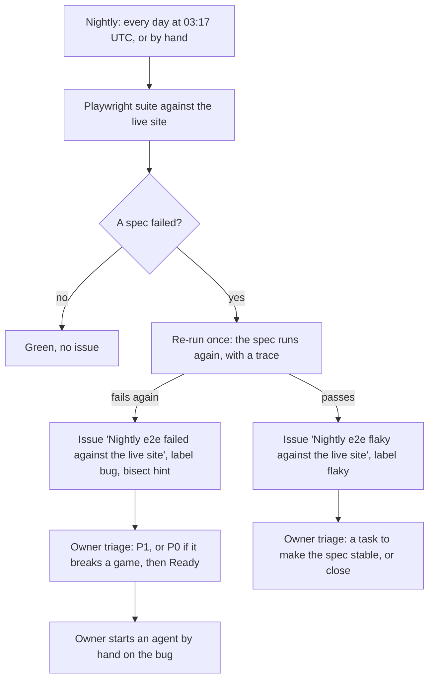

# CI repair: from a failed nightly to a fix (#168)

Status: in place. Free and deterministic: CI makes no LLM or agent call and uses no secret, only the
run's own `GITHUB_TOKEN` ([#74](https://github.com/TidyMaze/ab-alone/issues/74): free for now). CI
writes an issue that is ready to work on. An owner starts an agent on it by hand.

## 1. The flow

## 2. What the workflow does

`.github/workflows/nightly.yml`, one job:

1. Runs the Chromium suite against https://tidymaze.github.io/ab-alone/ with one worker and
   `--retries=1`. The retry is the automatic re-run: a failed spec runs once more in a new worker,
   and Playwright records a trace of that second run (`trace: 'on-first-retry'`). The JSON reporter
   writes `client/test-results/nightly.json`.
2. `client/scripts/nightly-report.mjs` (unit tested, run through `nightly-report-cli.mjs`) reads that
   report and sorts the run:
   - **pass**: every spec passed on its first run. Nothing else happens.
   - **flaky**: some specs failed, then passed on the retry, none failed twice. The job stays green.
   - **fail**: a spec failed on its first run and on the retry, or an error happened outside any
     spec, or Playwright wrote no report at all (an install step broke). The job is red.
3. On flaky or fail, uploads the artifact `playwright-report` (the HTML report and
   `test-results/` with the traces), kept 14 days.
4. Opens the issue, unless an open issue already has the same title.

The bisect hint (fail only) is plain `gh run list` and `git log`: the last successful nightly run on
`main` (a flaky run counts, the site worked), then the commits from the commit it tested to the
commit this run tested. A run dispatched on a branch tests that branch's specs, so its range also
holds the branch's commits.

## 3. What the issue holds

| | Bug (`bug`) | Flaky (`flaky`) |
|---|---|---|
| Title | Nightly e2e failed against the live site | Nightly e2e flaky against the live site |
| Layout | The Bug form headings: steps to reproduce, expected, actual, browser, OS and commit, broken feature | Flaky specs, reproduce, browser, OS and commit |
| Specs | Each failing spec: `file:line`, title, error lines (message, failing source line, location), its trace | Each flaky spec, with the error of the failed run and the trace of the retry |
| Reproduce | `git checkout <tested commit>`, then the failing specs against the live site | The same with `--repeat-each=10`: one run most likely passes |
| Also | Flaky specs of the same run, errors outside any spec, the bisect hint | "flaky, passed on retry": not a bug, no P1 |

Both link the run and give the commands to download the artifact and open the report and each
trace. At most 20 specs are listed, the body stays under GitHub's size limit.

## 4. What stays manual

- **Triage** (owners, or the lead agent on delegation, CONTRIBUTING.md section 6.2): confirm the
  bug, set `Priority`, link the broken feature, move it to `Ready`. The workflow cannot: the
  project belongs to a user account and `GITHUB_TOKEN` cannot edit its fields.
- **A flaky issue**: turn it into a task to make the spec stable, or close it if it does not come
  back. It never enters the bug flow.
- **A failure while its issue is still open**: no new issue and no comment. The nightly's run list
  shows each night.
- **The fix**: an agent or a human, started by hand, through the normal flow (sections 6.3, 6.4
  and 6.7). Nothing is fixed or merged automatically.
- **Checking the fix on the live site** after the merge and the Pages deploy:
  `gh workflow run nightly.yml --repo TidyMaze/ab-alone`.

## 5. Starting an agent on the bug

No LLM key lives in the repo or in Actions. The agent runs on the owner's machine, with the owner's
own account, in the owner's own clone.

1. Triage the bug as above, so it is `Ready` with a `Priority`.
2. Start your agent (for example Claude Code) in your clone and give it the issue:

   > Work on bug #N of TidyMaze/ab-alone. Follow AGENTS.md and CONTRIBUTING.md. Assign me and
   > comment `taking it`, branch `N-<slug>` from an up-to-date main. Reproduce with the command in
   > the issue and open the trace from the run artifact (commands in the issue). First commit a
   > test that fails because of the bug, then the fix. Run the local checks, then open a draft PR
   > with `Closes #N`.

3. The PR follows section 6.4: the lead agent or an owner marks it ready and merges it once the
   `rust` check is green.

A flaky issue turned into a task goes the same way, with the task's number.

## 6. Checking a change to the nightly

The nightly only runs on `main` by schedule, so a change to it is checked by hand on its branch:

1. Push a temporary commit that makes one live spec fail (a wrong expected text), then
   `gh workflow run nightly.yml --ref <branch>`. Check the bug issue it opens.
2. For the flaky path, a temporary spec that fails only on its first attempt:
   `expect(testInfo.retry).toBe(1)`, run alone.
3. Drop the temporary commit from the branch and close each test issue with a comment pointing at
   the task. The issues are real (same titles as the nightly's), so never leave one open.

The script's unit tests: `cd client && npx vitest run scripts/nightly-report.test.ts`.
