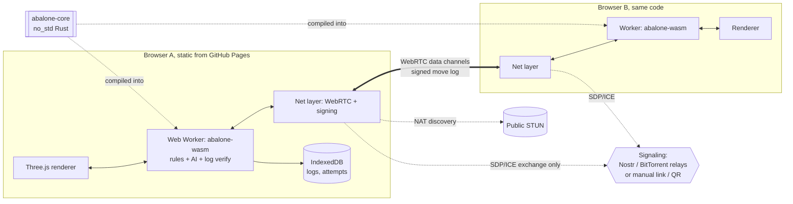

# Tech architecture and stack

Status: draft v0, for issue #17. Spec only, no code. Feature issues are listed in section 12.
Reworked after owner decision #36 (no server, P2P). Version facts below were checked on 2026-10-23 by web search. Where a source was secondary
(blog, distro tracker) it is marked **unverified**: pin versions from crates.io / npm when
Phase 0 starts.

## 1. Principles

1. One rules engine, written once in Rust, used by every peer (WASM), the CLI, the AI and the tests.
2. No server. Every peer runs the same deterministic engine and validates every move (#36).
3. Boring where it hurts (netcode, persistence: WebRTC, IndexedDB), fancy where it shows (renderer, AI, atmosphere).
4. Every hyped tech gets a verdict in section 11, so nobody re-debates it.

## 2. Architecture

Decision [#36](https://github.com/TidyMaze/ab-alone/issues/36): everything is static on GitHub
Pages, no game server, multiplayer is peer to peer (WebRTC data channels). Every peer runs the
same deterministic `abalone-core` WASM and validates every move.

Repo layout (when code starts, not now): `crates/abalone-core`, `crates/abalone-wasm`,
`crates/abalone-cli`, `client/` (Vite + TypeScript), `docs/`. One Cargo workspace, one `client/`
package. No server crate. Anything that needs a trusted server (accounts, ranking, global
leaderboard) is out of scope, see section 13.

## 3. Rust crate `abalone-core`

`no_std` friendly (`alloc` optional), no I/O, no clock, no global RNG, no threads. Fully
deterministic: same state plus same move gives the same state on every target. That property is
what makes prediction, replays and anti-cheat work.

**Representation (described, not coded).** Board of 61 cells, axial `(q, r)`. State is a compact
value type: two 61-bit bitboards (one per side, `u64` each) plus ejected counts and side to move.
For N-player arenas (radius 8, 217 cells) the state becomes a cell array with player ids, behind
the same API. Zobrist hash maintained incrementally.

**Public API shape**

| Area | Capability |
|---|---|
| Types | `Coord`, `Direction` (6), `Cell`, `Move` (group of 1..3 marbles in line, direction), `GameState`, `Outcome` |
| Query | `legal_moves(state)`, `is_legal(state, move)`, `cell(state, coord)`, `outcome(state)` |
| Transition | `apply(state, move)` returning new state plus an `Effects` list (slides, pushes, ejections) for the renderer |
| Reversibility | `undo` via returned undo token (needed by search) |
| Identity | `hash(state)`, canonical serialisation (stable, versioned binary + JSON) |
| Variants | `Ruleset` value: board radius, start layout (standard, Belgian daisy, custom), win threshold, hooks for modes (crumbling edges, hull breach) |
| Rounds | `resolve_round(state, orders)` for simultaneous play (battle royale), pure and order-independent |
| Notation | parse and print moves in a human format, used by logs, tests, CLI |

Modes add rules through `Ruleset`, they never fork the engine (SPEC section 2). `Effects` is the
only channel between engine and animation: the renderer never infers what happened by diffing.

Features: `serde` (off in `no_std` core build), `wasm` lives in a separate crate so the core has
zero wasm dependencies.

## 4. WASM build and JS bridge

- Crate `abalone-wasm` wraps the core with `wasm-bindgen`, built by `wasm-pack` (or plain
  `cargo build --target wasm32-unknown-unknown` plus `wasm-bindgen` CLI in CI). Latest seen:
  wasm-bindgen 0.2.129 and wasm-pack 0.15.0, both **unverified** (distro trackers, see
  [Debian tracker](https://tracker.debian.org/pkg/wasm-bindgen),
  [MSYS2](https://packages.msys2.org/packages/mingw-w64-clang-x86_64-wasm-pack)). Pin the exact
  version, the wasm-bindgen crate and CLI must match.
- The engine runs in a **Web Worker**. The main thread (render loop) never blocks on search.
- Bridge contract: JSON or a compact binary encoding, versioned, with generated TS types
  (`tsify` or `ts-rs`). Moves in, `{state, effects}` out. No object handles cross the boundary
  except one opaque engine instance per worker.
- Size budget: core + AI under 500 KB gzipped, `wasm-opt -O3`, reported in CI. Other assets: see the budget in section 9.
- Threads in wasm (SharedArrayBuffer) are **not** used at first: needs COOP/COEP headers, which
  GitHub Pages does not let us set. See section 9.

## 5. Renderer (comment on #14)

Three.js, TypeScript, Vite. Renderer behind a thin interface so scenes do not import backend
details.

**WebGPU vs WebGL.** Browser support is now broad: web.dev reports WebGPU in Chrome, Edge,
Firefox 141+ (Windows) and Safari 26, see
[web.dev](https://web.dev/blog/webgpu-supported-major-browsers?hl=en). Coverage is uneven on
Linux, Android and Intel Macs for Firefox (secondary sources, **unverified**). three.js
`WebGPURenderer` falls back to a WebGL2 backend automatically and the project states its focus is
on this renderer, see the [three.js manual](https://threejs.org/manual/en/webgpurenderer). I could
not confirm the current three.js release number or its "production ready" status from a primary
source: check the GitHub releases page when Phase 1 starts.

**Recommendation for #14:** `WebGPURenderer` with automatic fallback, from day one. We need the
fallback anyway, and writing materials in TSL (three's shader language, compiles to WGSL and
GLSL) avoids a second rewrite. Gate: if a visual feature cannot be done in both backends, it
degrades (fog and bloom stay, compute-based extras are WebGPU only and optional).

Scene notes: instanced meshes for marbles (61, up to 217), baked lighting plus a few dynamic
lights, fog and flicker as the Dead Space mood, post-processing chain with a single "clear
board" toggle that disables it (accessibility, SPEC section 5). Animations are driven by the
engine's `Effects` list, as timelines, so replays are free.

### 5.1 Post chain and quality tiers

Post chain, in order, built with three's node/TSL post-processing so one definition compiles to
both backends (to confirm per effect in a spike, see #31): scene fog (height and edge weighted:
denser toward the board rim, never over the playable cells, a mask pass keeps cells clear),
bloom, film grain, vignette, light flicker (driven by a seeded VFX clock, not the engine). Each
deck has a lighting preset (data, not code).

| Tier | Backend | Contents |
|---|---|---|
| Full | WebGPU | Whole chain, optional compute extras (particles) |
| Reduced | WebGL2 fallback, or user choice | Fog, bloom at half resolution, no grain, no compute, fewer dynamic lights |
| Clear board | any | No fog, no post chain, flat lighting (SPEC section 5 toggle, also the accessibility mode) |

Tier is picked at start from a one-frame benchmark and `prefers-reduced-motion`, always
overridable in settings. Degradation is a table, not an accident: a feature not in the tier is
off, never half-broken.

**Photosensitivity.** A flash limiter sits in the post chain and the flicker driver: luminance
changes are clamped to at most 3 flashes per second and a bounded area (WCAG 2.3.1). The
renderer reads `prefers-reduced-motion` as the default (reduced tier, no screen shake, no
flicker, shorter ejection animation) and the ejection VFX (#24) must ship a reduced variant. A
safe-mode switch in the first-screen options forces both.

### 5.2 Effects timeline: boundaries

`Effects` (section 3) drives all animation. Rules: VFX, audio and camera **never feed back into
the engine**; visual randomness (particles, flicker, shake) uses a separate seeded RNG owned by
the client, never the engine RNG, so replays and the P2P state hash are unaffected; effect
timelines are data with a duration and can be fast-forwarded (skip, replay, reconnect catch-up
applies the log without playing every animation).

### 5.3 Diegetic HUD text and accessibility

In-scene screens need readable text at 720p and at 200% UI scale. Options: render-to-texture
from a hidden DOM, CSS3D, SDF/MSDF text. **Recommendation:** MSDF text in-scene (crisp at any
scale, no DOM texture cost, works in both backends), with a **hidden accessible DOM mirror**
(turn, score, selected group, legal moves, last event) updated from engine state and marked
`aria-live`, which also feeds the flat HUD fallback (clear-board tier). Keyboard play (design
spec #38) uses the DOM mirror for focus. Contrast and size are checked on the flat HUD first.

### 5.4 Audio

Web Audio API directly (no Howler or Tone at first: a bus graph and a few players are small, and
a lib adds weight and hides the autoplay rules). Bus graph: `music`, `ambience`, `fx`, `voice`
into a master with a limiter, one gain slider per bus (world.md section 7 sliders) and a duck
node that lowers music and ambience under audio logs. Adaptive music: 2 to 3 stem layers
crossfaded by a tension value derived from engine state (marbles left, boss phase, breach
countdown). Hub positional sound: `PannerNode` (HRTF) per source. Cue selection is a pure map
from `Effects` (push size, ejection, faction) to a cue id plus variant. Procedural audio (synth
drones, filtered noise for decompression) is welcome for ambience since it costs no download.
**Autoplay:** browsers block audio before a user gesture, so the first screen is a "start"
click, which also hosts the accessibility options. Audio is a presentation layer only (5.2).
Tracked in #60.

### 5.5 Performance budget

Targets: 60 fps at 1080p on an integrated GPU in the full tier, 30 fps floor in the reduced
tier on a WebGL2-only low-end laptop (this answers the "WebGL2-only" question: playable, reduced
tier). Per frame: under 8 ms CPU main thread (engine and AI are in workers), under 10 ms GPU,
under 150 draw calls (instancing), memory under 500 MB. Measured by a Playwright perf test with
a fixed camera (reported, soft gate until Phase 1). Browsers throttle timers in background tabs:
P2P heartbeats, round deadlines and audio scheduling must not rely on main-thread `setTimeout`.
Run net timers in a worker and use `visibilitychange` to tell peers "away" instead of looking
dropped. WebGPU-only compute extras stay off the fog and bloom path.

### 5.x Renderer support per browser (#85)

`npm run e2e:all` runs the 13 e2e specs on Chromium, Firefox and WebKit (Playwright 1.63.0, base
commit 565cab7). The HUD states which backend three picked. Chromium here is headless Playwright,
which has no WebGPU adapter, so it falls back to WebGL2. A headed desktop Chrome with a GPU may
report WebGPU instead.

| Browser | HUD renderer | Specs passed |
|---|---|---|
| Chromium (headless) | WebGL2 | 13 of 13 |
| Firefox | WebGL2 | 13 of 13 |
| WebKit (Safari engine) | WebGPU | 13 of 13 |

## 6. Peer-to-peer multiplayer (decision #36; comments on #13)

**Trust model.** No trusted party. Every peer replays every move with the same deterministic
engine, so an illegal move is rejected by all honest peers and the cheater's session is dropped.
What P2P cannot stop: a player sitting at two seats (collusion in battle royale), clock
disputes, and a modified client that only *refuses* to play. Accepted for a hobby game. There is
no hidden information in Abalone, so nothing leaks. Single-player and bosses are trusted-client.

**Transport.** WebRTC data channels, reliable and ordered (SCTP). A browser API, works on every
current browser, needs no server of ours. (WebSocket and WebTransport are dropped: both need a
server we no longer have.)

**Signaling without our server.** Two peers must swap an SDP offer/answer and ICE candidates
once, through some channel. Options:

| Option | Server of ours | Pros | Cons |
|---|---|---|---|
| Manual invite: SDP packed into a link or QR, answer sent back by the guest | none | Zero dependency, works forever | 2 copy-paste steps, bad UX for 6 players |
| Trystero over **Nostr** relays ([github](https://github.com/dmotz/trystero), [npm](https://npmjs.com/package/trystero)) | none | Join by room code, library handles it, public relays, redundancy | Depends on third-party public relays, relays can rate-limit or vanish. Nostr is the current default strategy per npm docs (**unverified** against source) |
| Trystero over BitTorrent trackers / MQTT / IPFS | none | Same API, can swap strategy | Same dependency class, tracker uptime varies |
| Trystero over Firebase / Supabase | free tier of a vendor | Reliable | Account, quota, a vendor key in the client |
| Own relay (WebSocket, tiny) | yes | Full control | Breaks decision #36 |

**Recommendation:** Trystero with the Nostr strategy (BitTorrent as automatic second strategy)
for room codes, **plus** the manual link / QR flow as an always-available fallback and for LAN
play. The signaling layer sits behind a small interface (`create_room`, `join_room`, `signal`)
so a strategy can be swapped without touching game code. Signaling carries only SDP/ICE, never
game data. Room codes are random 8+ characters, and the first message in a room is a signed
`Hello` carrying the peer's public key (see Identity).

**NAT traversal and TURN.** Public STUN (for example Google's) is free and enough for most home
networks. Estimates of sessions that need a TURN relay run from about 10 to 25 percent, mostly
symmetric NAT, carrier-grade NAT on mobile and corporate networks (vendor blogs, rough,
**unverified**, see [Forasoft](https://www.forasoft.com/learn/video-streaming/articles-streaming/nat-stun-turn-ice-webrtc)). A TURN server is a server, and static hosting cannot hide TURN credentials
in client code. Options: none; a free-tier hosted TURN with credentials public in the client
(abuse and quota risk, I found no reliable current free public TURN service, check before
relying on one); self-hosted coturn (costs money, breaks #36). **Recommendation:** v1 ships
no TURN, with STUN and a clear "cannot connect directly" screen that offers the manual flow and
a different network. Measure the failure rate with local telemetry (section 10) and revisit.

**Identity and integrity.**
- Each browser creates an Ed25519 keypair per session (WebCrypto) kept in memory plus
  IndexedDB. `Hello` binds the key to a display name and seat.
- Every move is a signed message `{game_id, seq, prev_hash, move, sig}`. `prev_hash` chains
  moves, so the log is tamper-evident and any peer can prove who played what.
- After every move each peer checks `hash(state)` equals the sender's claimed post-state hash.
  A mismatch is a desync report, the game pauses and shows the divergence (engine bug or cheat).

**1v1 (and any turn-based mode).** Lockstep: only the side to move may send, both apply. No
host needed, no arbitration, the two engines must agree. Prediction is free (local apply is the
real apply). Rematch with colour swap is a new game on the same channel.

**Rematch (#186).** Once the game is over, each seated player may send a signed
`Rematch {game_id, pub, sig}` bound to the finished game id. It is sent only while the key of
every other seat is connected, like a move (#143). A peer refuses an ask with a bad signature, for
another game id (stale), or from a key without a seat. An ask can come before the last move on
another channel, so a peer keeps it and starts the new game only once every seated key asked and
the game is over on its own engine. The new game: id `hex(SHA-256(["rematch", old_id]))`, the same
on every peer and never an earlier id of the room; a fresh move log from the genesis hash; the
engine at the start position; the colours swapped, so the former White plays Black and moves first
(rules.md section 10.2). The seats stay bound to the same keys and `Hello` stays bound to the
room id (the id of its first game), so a reconnect works in any game of the room. A move or an ask
signed for the old game id is refused. Spectators stay spectators and follow the new game.
An ask in flight when the connection drops is lost, so asks are sent again on reconnect (#198).
When a seated key says `Hello` again, a player that asked for a rematch of the current game sends
its signed ask again. A player that already started the new game keeps its own signed ask of the
finished game: when a seated key asks again for that finished game, it still refuses that ask
(stale) but sends its kept ask back, once per `Hello` of that key so two peers never echo each
other. The late peer then has every ask and starts the same new game.

**Battle royale (recommendation for #13: simultaneous, commit-reveal lockstep).**
1. Round opens at a deadline all peers compute from the round-start message (no trusted clock,
   deadlines are relative: "30 s after the previous round resolved on my screen", with the
   coordinator's start message as reference).
2. **Commit:** each peer broadcasts `H(order || nonce)` signed. Nobody can change their order
   after seeing others.
3. **Reveal:** once all live peers committed (or the deadline passed: missing = `hold`), each
   broadcasts `order || nonce`. Peers verify against the commit. A bad reveal counts as `hold`
   and flags the peer.
4. **Resolve:** every peer runs `resolve_round(state, orders)` locally. It applies the orders
   one by one in a rotating initiative order (derived from round number and seat list), each
   validated at its turn, an invalid order becomes a pass (game design #53, option C). Pure, so
   all peers reach the same state, checked by hash. Bots: orders are a pure function of
   (round-start state, seed), computed before reveal.
- **Who arbitrates?** Nobody has authority over the outcome, the pure function does. A
  **coordinator** (the host peer) exists only for liveness: it announces round start, collects
  the timeout decision and drives membership. If the coordinator lies about a deadline, peers
  fall back to their local deadline. This keeps the host from becoming a cheating vector.
- Topology: full mesh, at most 6 players means 15 connections, which is fine for tiny messages.
- Conflict rules (two orders on one cell, push versus move) are game design, see #13 and #49.

**Host / coordinator migration.** State is fully replicated, so the host holds no unique data.
When the coordinator's channel drops (heartbeat 5 s, three misses), the live peer with the
lowest `join_seq` becomes coordinator, announces it, and every peer acknowledges. Same
deterministic rule on every peer, so no election round is needed. In 1v1 there is no host.

**Reconnection.** A peer that drops keeps its keypair and seat for a grace period (default 60 s
in 1v1, 2 rounds in royale, tunable; timer is local to each peer, so disagreement possible, in
which case the coordinator's decision applies and is logged). It returns through the same room
code, proves its key, and any live peer sends the move log tail from its last `seq`. A page
reload resumes from IndexedDB. If everyone leaves, the game is lost unless a peer saved it, so
each peer persists the log locally and a finished or abandoned game can be exported or resumed
by the same pair.

**Spectators.** Join the room as read-only peers (no seat, no signing rights). To avoid a mesh
of N spectators, each connects to one or two seated peers that forward the signed log (relay
tree, peers cap their spectators, default 4). Spectators verify signatures and replay locally,
so they trust nobody. Beyond the cap the room shows "full". Replays: the signed log is the
replay file.

**Clock.** No server time. Chess-clock style: each peer measures its own opponent's thinking
time and both exchange timestamps; the lower claim of elapsed time for the mover is not
trusted, so time controls are **advisory** in v1 (shown, enforced only by mutual agreement on
timeout). A trustworthy clock needs a server, out of scope.

**Prediction.** Not needed: a move is applied locally the moment it is sent, since the engine is
the same everywhere. Network latency only affects when the opponent sees it.

## 7. AI and bosses

All AI lives in `abalone-core` or a sibling crate `abalone-ai`, runs as WASM in a Web Worker (and natively in
the CLI and in CI for self-play).

- **Alpha-beta** (negamax, iterative deepening, Zobrist transposition table, killer and history
  heuristics, move ordering by ejections then pushes). Casual AI is time-boxed (`search(state, budget_ms)`); **bosses are depth or node limited** so a
  retry with the same seed plays the same game on every machine. Boss hooks run inside `apply`
  so the search sees them.
  Eval trait, first impl hand-tuned: ejection difference, centre distance, cohesion, edge danger.
  This is enough for the 2-player Phase 3 bosses.
- **MCTS** for N-player arenas and royale, where alpha-beta does not apply cleanly. Later.
- **Learned eval.** Train a small value network on self-play from the alpha-beta engine, ship as
  a quantized MLP evaluated in plain Rust (no ML runtime in the browser). Later, only if the
  hand-tuned eval plateaus. Verdict "Later" in section 11.
- **Boss = search + personality.** Depth, eval weights and a script of phase changes (SPEC
  section 4). The "tell" is the engine announcing a planned special move one turn ahead, so the
  boss API needs `plan_special(state) -> Option<Telegraph>` next to `best_move`. Playtest logs
  (win rate per attempt) are stored for tuning, see persistence.
- Determinism: bosses use a seeded RNG so a run can be replayed from the log.

## 8. Persistence

No database server. Everything is client-side.
- **IndexedDB** (via a small wrapper): signed move logs (`game`, `move_log`), boss `attempt`
  records for the souls-like tuning (boss id, outcome, move count), settings, the session
  keypair. A game is its ruleset + seed + signed log.
- **Export/import:** a game or the whole save as a JSON file (also the bug report format and the
  backup, because browsers can clear storage). `navigator.storage.persist()` requested.
- **Cross-device progress** is out of scope (no accounts, SPEC section 6). Export file is the
  workaround.
- Telemetry (boss win rate per attempt) stays local by default. An opt-in "send my attempts" can
  post to a GitHub issue template or a static form later, decided with #48.

## 9. Hosting and delivery

- **Everything on GitHub Pages**, deployed by Actions from `main`. Cost: zero.
- Pages limits to know: no custom response headers, so no COOP/COEP, so no SharedArrayBuffer
  wasm threads (not needed). Soft limits of about 1 GB site size and 100 GB per month bandwidth
  (from memory, **unverified**, check GitHub docs): keep wasm and assets small, use compressed
  textures and audio. Cloudflare Pages is an escape hatch if a header ever matters.
- **Asset pipeline (#61).** Models: glTF with meshopt compression. Textures: KTX2/Basis
  (GPU-compressed, small download). Audio: Opus in WebM or Ogg, with an AAC fallback only if
  Safari needs it. Lazy loading per deck, the hub loads a first deck only. Budget (starting
  values, soft until Phase 1): initial load under 5 MB gzipped (wasm + JS + first scene), each
  deck under 15 MB, whole site under 250 MB, well below the Pages soft limits. CI reports and
  fails on regressions. Source files (blend, wav) stay out of the Pages artifact. Who makes
  assets is a design question (world spec open questions), and procedural or generated assets
  are preferred for the first decks.
- Versioning: the wire protocol and the engine carry a version number in `Hello`. Peers on
  different engine versions refuse to play (a desync otherwise). Old tabs are told to reload.
- Only third-party runtime dependencies: public STUN, signaling relays. Both degrade to the
  manual flow, single-player never needs them.

## 10. CI, testing, observability

**CI (GitHub Actions):** `cargo fmt --check`, `clippy -D warnings`, `cargo test` (native),
`wasm-pack test --node` (wasm32), `cargo deny` / `cargo audit`, client typecheck + lint +
Vitest, build, Pages deploy on main. Toolchain pinned by `rust-toolchain.toml`, cargo cache,
target under 10 min.

**Testing strategy**
- **Property tests** (`proptest`): marble count never changes except by ejection, every
  `legal_moves` entry passes `is_legal`, `undo(apply(m)) == id`, state hash is stable, wasm and
  native agree.
- **Perft:** node counts at depth 1..N from the start position and from hand-built tricky
  positions (sumito at the edge, blocked pushes). Reference: a second implementation or a
  published table. Perft is the engine's truth test.
- **Golden games:** recorded games replayed on every build, hash compared.
- **Cross-target determinism:** same move list on native and wasm32, compare final hash.
- **Netcode:** an in-memory fake transport that drops, reorders, duplicates and delays messages
  (reconnect, double send, spectator catch-up, coordinator migration, commit-reveal with a
  silent or lying peer). Royale resolver: order-independence property. One real WebRTC
  loopback test in Playwright (two pages) per CI run.
- **Renderer:** Playwright smoke test per backend (WebGPU, WebGL2), screenshot of the start board
  with tolerance. Visual changes reviewed in the PR.
- **AI:** self-play gauntlet in CI nightly, Elo vs fixed baselines, fail on regression.

**Observability (client-side only):** structured console logger with levels, a local ring buffer
of the last 1000 events (net, desync, search time), and a "copy diagnostics" button that exports
it with the game log, since the signed log reproduces any bug. Local counters: connection
success and failure by cause (ICE failed, signaling timeout), time to connect, desync reports.
Those counters drive the TURN decision (section 6). Boss analytics come from the local `attempt`
table. No third-party SDK, no data leaves the browser unless the player exports it.

## 11. Trending tech considered

| Tech | Verdict | Why |
|---|---|---|
| Rust + WASM engine | Adopt | The core bet: one rules engine for every peer, the CLI and tests |
| three.js WebGPURenderer + TSL | Adopt | Fallback to WebGL2 is built in, broad browser support (section 5) |
| WebRTC data channels (P2P) | Adopt | Decision #36: no server, deterministic engine on every peer validates |
| Trystero (Nostr / BitTorrent signaling) | Adopt | Serverless room codes; manual link / QR kept as fallback |
| WebSocket game server (axum) | Reject | Dropped by #36, nothing to host it |
| Own TURN server (coturn) | Reject | A server and a bill, breaks #36. Revisit only if measured failure rate hurts |
| WebTransport | Reject | Client-server only (Baseline since Safari 26.4, unverified), and we have no server. P2P WebTransport does not exist in browsers |
| Bevy (Rust engine, v0.20 seen, [bevy.org](https://bevy.org/news/)) | Reject | Asked for Three.js, and a full engine duplicates what we need; wasm size and iteration cost |
| ECS (as architecture) | Reject | 61 cells, a bitboard beats an ECS. Maybe for the hub world (Phase 5), decide then |
| WebGPU compute (particles, fog) | Later | Pure eye candy, optional, WebGPU-only, after the board works |
| Tauri desktop app | Later | Wrap the static client once the game is fun. Mobile and desktop native are out of scope today |
| CRDTs (Automerge, Yjs) | Reject | Turn-based hash-chained signed log is simpler and tamper-evident; CRDTs solve concurrent edits we do not have |
| Edge workers (Cloudflare Durable Objects) | Reject | A server by another name, breaks #36 |
| LLM-driven boss dialogue | Later | Fun for lore, but latency, cost, moderation, non-determinism. Pre-written lines first, LLM behind a flag, never in the move path |
| Learned eval / AlphaZero style net | Later | Only if hand-tuned eval plateaus; ship as plain Rust MLP, no ML runtime |
| Gaussian splats | Reject | Static captured scenes, we have a stylised synthetic ship. Heavy for no gain |
| WebXR | Reject | Not now. Cheap to revisit later since three.js supports it, but input and comfort design is a whole project |
| Web Audio API (direct) | Adopt | Bus graph, adaptive layers and HRTF panning need no lib. Howler/Tone: Later if the graph gets complex |
| Spatial audio (PannerNode HRTF) | Adopt | Hub rooms need positional sound, built into Web Audio |
| Procedural audio | Adopt | Ambience and decompression synthesized, zero download |
| MSDF text for in-scene HUD | Adopt | Readable at any scale, plus a DOM mirror for screen readers |
| KTX2 + meshopt | Adopt | Small downloads under the Pages bandwidth budget |
| Web Workers for AI | Adopt | Keeps the render loop smooth, no headers needed |
| WASM threads (SharedArrayBuffer) | Reject | Needs COOP/COEP, not possible on GitHub Pages, not needed at our search depth |
| IndexedDB + JSON export | Adopt | Only persistence available client-side, move log is tiny |
| SQLite in wasm (OPFS) | Later | Only if queries over logs get complex |
| WebCodecs / video | Reject | No video in the game, lore is audio and environment |

## 12. Feature issues derived from this spec

Issues #33, #34, #35, #39 were rewritten for P2P after #36.

| Issue | Area |
|---|---|
| #23 abalone-core: board, move generation, validation, sumito | engine |
| #25 Engine test harness: property tests and perft | engine |
| #27 WASM build and JS bridge | engine |
| #29 AI: alpha-beta with hand-tuned eval, in a Web Worker | engine |
| #31 Three.js renderer: WebGPU with WebGL fallback | client |
| #33 P2P networking: WebRTC, serverless signaling, signed move log | client |
| #34 Reconnection, host migration, spectators, replay | client |
| #35 Battle royale: commit-reveal simultaneous rounds | engine |
| #37 CI: GitHub Actions, Pages deploy | engine |
| #60 Audio engine: Web Audio bus graph, adaptive layers, spatial hub sound | client |
| #61 Asset pipeline: glTF, KTX2, Opus, lazy loading, size budget | client |
| #39 Local persistence (IndexedDB) and client observability | client |

Suggested order: #23, #25, #37 (Phase 0), then #27, #31 (Phase 1), then #33, #34, #39 (Phase 2),
#29 (Phase 3), #35 (Phase 4).

## 13. Open questions

1. Is "cheating is detectable, not preventable" acceptable? No ranking or accounts (SPEC section
   6) makes it cheap to accept. A ranked ladder would need a server and reopens #36.
2. TURN: ship v1 without it, and what failure rate (measured locally, about 10 to 25 percent
   estimated) triggers a rethink?
3. Signaling dependency: are we fine relying on public Nostr / BitTorrent relays, with the
   manual link as fallback?
4. Royale order timer and the exact conflict rules (#13, #49): game design input needed.
5. Time controls are advisory in v1. Is that enough for 1v1 (#41)?
6. Draw / anti-stalling rule (#12, #40) affects `outcome`, the AI and the signed log.
7. Perf targets in 5.5 are starting values: who owns the low-end reference machine?
8. Who produces the art and audio assets (world spec open question)? Drives the budget in 9.
